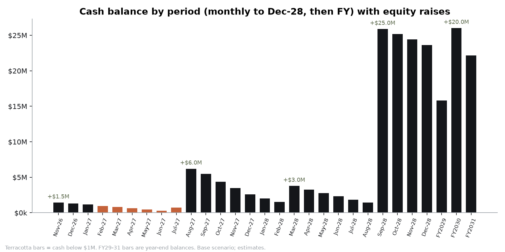

# Fundraising plan

*Base scenario of `LORE_Financial_Model.xlsx` (sheets `Funding & Runway`, `Cap Table`, `Runway`). All valuations are planning assumptions, not offers. **No investor has committed.** The target list below names well-known firms whose public portfolios fit the thesis, and every fit must be re-checked before outreach.*

## 1. Round plan

| Round | When | Amount | Instrument / valuation | Founder FD after | Gate to raise it |
|---|---|---:|---|---:|---|
| **Pre-seed** | Nov-2026 | **$1.5M** | Post-money SAFE, $12M cap (COMPANY.md) → 12.5% | 78.8% | Prototype app + Rome pack; ODM shortlist |
| **Seed** | Aug-2027 (after Kickstarter) | **$6.0M** | Priced Seed preferred, $22M pre / $28M post; pool topped up to 12% | 57.5% | KS ≥ $1M & ≥ 3,000 backers (GTM gate G2); DVT units working; cert plan |
| **Seed-2 extension** *(CFO addition)* | Mar-2028 | **$3.0M** | Seed-2 at $36M pre (step-up of ~1.3x on Seed price). Alternative: inventory/venture-debt facility (Kickfurther, Flexport Capital, Clearco: see legal-ops/supply-chain-ops.md) | (5.5% dilution) | KS shipped on time; return rate < 5%; first retail PO |
| **Series A** | Sep-2028 | **$25M** | $80M pre / **$105M post**; pool to 13% | 37.7% | See §4. Revenue run-rate ≥ $10M, 7k+ paid subs, D11 Square cost-down proven, 20 cities |
| **Series B** | 2030 | **$20M** | ~$230M pre (growth / working capital for retail) | 34.7% | FY29 revenue ≥ $30M, ARR ≥ $3M, blended GM ≥ 33%, path to EBITDA+ in FY31 |
| **Total** | | **$55.5M** | | | |

**Funding need.** The peak cumulative operating + investing outflow is **$33.4M**: the base-case EBITDA losses of FY27-FY30 plus working capital (inventory ≈ $8M by FY31) and tooling. The planned $55.5M leaves ≥ $15M of minimum year-end cash after the Seed and **$22M at end-FY2031**. That buffer covers the holiday inventory build and the bear-case risk. In the bear case the same rounds leave the company **$16.6M short by FY2031**, so equity of ≈ $72M would be needed.

## 2. Use of funds and milestones by round

| Window (round funding it) | Net burn | People | NRE & cert | Inventory (ODM payments) | Tooling capex | Marketing | Milestones bought |
|---|---:|---:|---:|---:|---:|---:|---|
| Nov-26 → Jul-27 (pre-seed + KS) | $0.79M | $0.68M | $0.33M | – | $0.19M | $0.36M | App prototype + Rome; ODM selected Jan-27; 50 EVT units Q1-27; Kickstarter May-Jun 27 |
| Aug-27 → Feb-28 (Seed) | $5.2M | $1.27M | **$1.80M** (cert $1.29M for 3 SKUs) | $1.53M | $0.52M | $0.33M | DVT/PVT; FCC/CE/UKCA/PTCRB/GCF/NTN cert; first 5k units shipped Nov-27→Jan-28 |
| Mar-28 → Aug-28 (Seed-2) | $3.1M | $1.75M | $0.05M | **$3.03M** | – | $1.03M | Atlas Founders ship Apr-28; retail launch; Square Cat-1bis cost-down (D11); 20 City Packs |
| Sep-28 → Dec-28 (Series A) | $2.8M | $1.36M | – | **$4.23M** | $0.14M | $1.04M | First holiday season (≈ $5M revenue in Q4-28); B2B fleet pilot (600 devices) |
| FY29-FY30 (Series A + B) | $17.6M | most of opex ($17.7M → $30.6M) | Gen-2 NRE $1.3-1.8M/yr | growing | $1.3M | S&M 27% → 24% of revenue | 120k → 250k units; EU/APAC; 70+ cities; EBITDA+ FY31 |

## 3. Investor target list (by type; fit rationale; no commitments)

| Type | Firms / people (publicly known) | Why they fit | Round |
|---|---|---|---|
| Hardware-specialist seed | Root Ventures; Bolt; Eclipse; HCVC (Hardware Club, Paris); Lux Capital | Invest pre-revenue in physical products and understand NRE/cert timelines | Pre-seed, Seed |
| Consumer seed / brand | Forerunner Ventures; Lerer Hippeau; Female Founders Fund; BoxGroup | Consumer brands and DTC; Forerunner was an early Oura backer | Seed |
| AI-native seed | Conviction; South Park Commons; Neo; AI Grant (N. Friedman / D. Gross) | Edge AI + voice-first interface thesis | Pre-seed, Seed |
| Travel-tech specialists | Thayer Ventures; JetBlue Technology Ventures; Amadeus Ventures; Plug and Play Travel & Hospitality | Distribution, eSIM/booking partnerships, affiliate revenue | Seed-2, A |
| Consumer-device growth | GV, EQT Ventures, Highland Europe, Tiger Global (all in Nothing's 2025 round); IVP; SoftBank Vision Fund 2 (Whoop 2021); Fidelity (led Oura Series E); Khosla Ventures (backed Rabbit) | Have backed hardware + subscription at scale | A, B |
| Strategics | Connectivity: eSIM MVNEs and carriers. OTAs/experiences: Booking, Expedia, GetYourGuide. Audio: Shokz-type OEMs. Silicon vendors' venture arms (e.g., Qualcomm Ventures) | Lower data COGS, distribution, component supply | A (minority), commercial deals |
| Angels (categories) | Hardware founders/operators (e.g., Build Collective, Tony Fadell's investment office); founders of travel marketplaces; eSIM founders; ex-Apple/Garmin/Oura product leads; travel creators with large audiences | Credibility, ODM and retail introductions, launch reach | Pre-seed, Seed |
| Crowdfunding-adjacent | Kickstarter itself is the community round; consider a Reg CF/community round after delivery (Nothing raised community rounds) | Converts backers into owners and evangelists | Post-Series A |

Sources for the portfolio claims: Nothing Series C investors (https://yourstory.com/2025/09/nothing-smartphones-series-c-funding-tiger-global-nikhil-kamath-unicorn), Whoop/SoftBank 2021 (https://www.nippon.com/en/news/reu20210830KBN2FV16Y/), Oura Series E led by Fidelity (https://www.fiercehealthcare.com/health-tech/oura-raises-900m-series-e-oura-ring-sales-catapult). Other firm-thesis statements are from general knowledge and **must be verified** before outreach.

## 4. What each round must prove (data-room checklist)

- **Seed:** KS ≥ $1M / ≥ 3,000 backers at cost per backer < $60; EVT Map Vision accuracy data; signed ODM term sheet (VN/MY, D13); cert budget; pre-order deferred revenue reconciled to backers.
- **Series A ($105M post):** ≥ 40k units shipped; return rate ≤ 4%; trial→paid ≥ 35% with month-3 churn ≤ 6%; Square landed ≤ $185 (D11); blended GM ≥ 25% trending to 35%; 20 cities; Q4-28 retail sell-through. Valuation logic is in `valuation.md`. **If the Q4 data is not in yet, raise in Jan-Feb 2029 instead** and extend the Seed-2 to $5M.
- **Series B:** FY29 revenue ≥ $30M (+200%), ARR ≥ $3M, CAC ≤ $65, inventory turns ≥ 6, EBITDA margin improving ≥ 10 points a year.

## 5. Cap table summary (fully diluted, formulas in `Cap Table`)

| Holder | Formation | Post SAFE | Post Seed | Post Seed-2 + A | Post B |
|---|---:|---:|---:|---:|---:|
| Founder | 90.0% | 78.8% | 57.5% | 37.7% | 34.7% |
| Option pool | 10.0% | 8.8% | 12.0% | 13.0% | 12.0% |
| Pre-seed SAFE | – | 12.5% | 9.1% | 6.0% | 5.5% |
| Seed | – | – | 21.4% | 14.1% | 12.9% |
| Seed-2 | – | – | – | 5.5% | 5.0% |
| Series A | – | – | – | 23.8% | 21.9% |
| Series B | – | – | – | – | 8.0% |

Series B: $20M at $250M post. Founder stake at the Series A price ≈ $40M. Liquidation preferences (assumed 1x non-participating) are not modelled.
