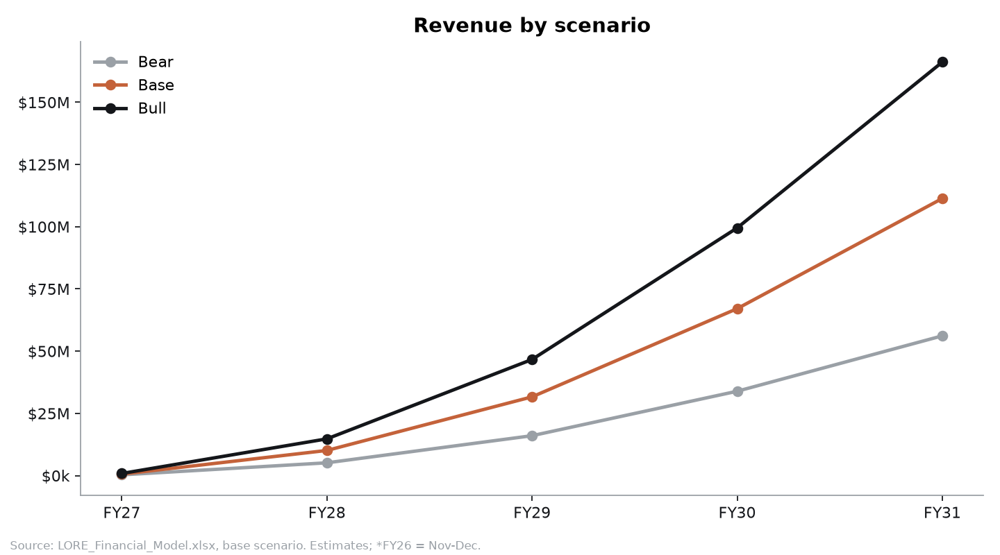

# Pricing & margin sensitivity

*Two layers:*
1. *The **live grid** in `LORE_Financial_Model.xlsx` → `Unit Economics` (rows below the SKU table) gives DTC hardware gross margin by price × landed-COGS change for each SKU, and it recalculates when you change inputs.*
2. *The **whole-model reruns** below come from `scripts/sensitivity.py`, which rebuilds the workbook with one input changed, recalculates it in LibreOffice and writes `sensitivity_results.json`.*

*All figures are estimates; base = Research final prices + hardware/bom COGS.*

## 1. Whole-model sensitivities

| Case | FY28 revenue | FY31 revenue | FY28 GM | FY31 GM | FY30 EBITDA | FY31 EBITDA | Peak cumulative burn* | First EBITDA+ year |
|---|---:|---:|---:|---:|---:|---:|---:|---|
| **Base** | $10.0M | $111.3M | 23.9% | 39.7% | −$6.6M | −$0.6M | $37.1M | after FY31 (≈ break-even FY31) |
| Square MSRP $349 (KS $259 / pre-order $299) | $10.7M | $117.7M | 28.3% | 42.8% | −$2.8M | +$5.4M | $25.9M | FY2031 |
| Square value-engineered to $185 FOB | $10.0M | $111.3M | 29.1% | 43.6% | −$3.8M | +$3.7M | $26.8M | FY2031 |
| **Square $349 + VE $185 FOB** (CFO recommended) | $10.7M | $117.7M | 33.2% | 46.5% | −$0.0M | **+$9.7M** | **$20.4M** | FY2031 (FY30 ≈ 0) |
| Atlas back to $549 | $9.8M | $109.0M | 22.1% | 38.5% | −$8.0M | −$2.9M | $41.7M | after FY31 |
| Pebble full spec (on-device 1B, $125 FOB) | $10.0M | $111.3M | 13.0% | 31.6% | −$12.5M | −$9.7M | $58.4M | after FY31 |
| China FATP, +20% of FOB tariff | $10.0M | $111.3M | 11.4% | 30.4% | −$13.3M | −$11.0M | $61.6M | after FY31 |
| Explorer attach −25% | $9.9M | $108.8M | 23.5% | 38.9% | −$7.6M | −$2.6M | $40.5M | after FY31 |
| Churn 8%/mo (vs 6%) | $10.0M | $109.8M | 23.8% | 39.2% | −$7.1M | −$1.8M | $39.0M | after FY31 |
| Churn 4%/mo | $10.0M | $113.4M | 23.9% | 40.4% | −$5.9M | +$1.0M | $34.6M | FY2031 |
| eSIM data $3.00/GB (vs $1.60) | $10.0M | $111.3M | 23.1% | 38.7% | −$7.3M | −$1.8M | $39.4M | after FY31 |
| Retail margin 45% (vs 38%) | $9.9M | $108.7M | 22.8% | 38.3% | −$8.1M | −$3.0M | $41.5M | after FY31 |
| DTC promo discount 12% (vs 6%) | $9.6M | $107.2M | 20.4% | 37.6% | −$9.0M | −$4.6M | $45.4M | after FY31 |

*Peak cumulative operating + investing cash outflow: the minimum equity needed before any cash buffer.

**Scenario toggles** (sheet `Scenarios`) multiply volume, price, attach, churn, COGS and CAC together:

| | FY28 revenue | FY31 revenue | FY31 EBITDA | FY31 ending cash (planned rounds) |
|---|---:|---:|---:|---:|
| Bear (0.55× volume, −7% price, 0.7× attach, 1.3× churn, +10% COGS, 1.35× CAC) | $5.1M | $56.2M | −$23.2M | **−$3.6M (needs ~$74M equity)** |
| Base | $10.0M | $111.3M | −$0.6M | $33.4M |
| Bull (1.45× volume, 1.25× attach, 0.8× churn, −5% COGS, 0.85× CAC) | $14.6M | $166.1M | +$22.4M | $66.8M (EBITDA+ from FY2030) |

## 2. DTC hardware gross margin grid (FY2028 cost basis)

Formula: 1 − (landed × (1+Δ) + $11 fulfilment + net price × (2.9% + 2%) + $0.30) ÷ (MSRP × 0.94 × 0.96).

**Square** (landed $227.16)

| MSRP \ COGS Δ | −15% | −10% | −5% | 0% | +5% | +10% | +20% |
|---|---:|---:|---:|---:|---:|---:|---:|
| $249 | 15% | 10% | 5% | **−0%** | −5% | −10% | −19% |
| $279 | 24% | 20% | 15% | 11% | 7% | 2% | −7% |
| **$299** | 29% | 25% | 21% | **17%**¹ | 12% | 8% | 0% |
| $329 | 35% | 31% | 28% | 24% | 20% | 16% | 9% |
| $349 | 39% | 35% | 31% | **28%** | 24% | 21% | 14% |

¹ This grid excludes the returns allowance in COGS. It is shown on net-of-returns revenue, so it reads higher than the 7% in `unit-economics.md`, which also deducts discount and returns from gross price. Use the workbook grid for exact values.

**Pebble (Lite/ECR spec, $62.65 landed)** at $149 MSRP gives ≈46% DTC GM. At $129 it is ≈38%; at $119, ≈33%.
**Atlas ($317.39 landed)**: at $599 ≈37%; at $549 ≈31%; at $649 ≈42%.

## 3. Recommendations (founder decisions)

1. **Fix Square before the Kickstarter price is locked (by Mar-2027).** Either (a) list Square at **$349** (Research's Gabor-Granger test includes a $349 cell, so test it), or (b) set Hardware a **$185 FOB value-engineering target**: 2-3 GB DRAM with a smaller on-device model, LTE Cat-1bis in place of Cat-4, and a renegotiated display. Doing both takes FY2031 EBITDA from −$0.6M to +$9.7M and cuts the equity need by about $17M.
2. **Ship Pebble at the ECR (cloud-AI) spec.** The full on-device spec costs about $9M of FY2031 EBITDA.
3. **Lock in non-China final assembly (VN/MY/TH).** A 20% tariff is the single biggest downside, at −$10M of EBITDA a year (legal-ops/supply-chain-ops.md already shortlists non-China FATP).
4. **Keep promotions under 8% blended.** Every 6 points of discount costs ≈$4M of FY2031 EBITDA.
5. **Treat retail as distribution for Pebble and Atlas only** until Square's cost-down lands. At $299, a Square sold through retail loses money.
