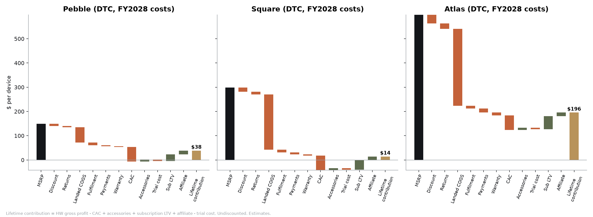

# Unit economics per SKU

*Source: `LORE_Financial_Model.xlsx` → sheet **Unit Economics** (live formulas), base scenario, FY2028 cost basis. All figures are estimates. Landed costs are **reconciled to `hardware/bom/cogs_summary.csv` (10k tier, 30 Oct 2026)**. Prices are **Research final** (`research/pricing-research.md`).*

## 1. Per-device economics, DTC channel ($ per unit)

| Line | Pebble $149 | Square $299 | Atlas $599 |
|---|---:|---:|---:|
| MSRP | 149.00 | 299.00 | 599.00 |
| DTC promo discount (6%) | −8.94 | −17.94 | −35.94 |
| Returns allowance (4%) | −5.60 | −11.24 | −22.52 |
| **Net revenue** | **134.46** | **269.82** | **540.54** |
| Landed COGS (hardware/bom FOB + royalties + ~1% freight, 0% duty VN/MY FATP) | −62.65 | −227.16 | −317.39 |
| Fulfilment (3PL + outbound) | −11.00 | −11.00 | −11.00 |
| Card processing (2.9% + $0.30) | −4.36 | −8.45 | −16.63 |
| Warranty reserve (2%) | −2.80 | −5.62 | −11.26 |
| **Hardware gross profit** | **53.64 (40%)** | **17.59 (7%)** | **184.26 (34%)** |
| Paid CAC (FY2028, $60) | −60.00 | −60.00 | −60.00 |
| Hardware contribution after CAC | −6.36 | −42.41 | 124.26 |
| Accessories GP (30% attach × $45 AOV × 62% GM) | +8.37 | +8.37 | +8.37 |
| Free 3-month Explorer trial (cloud cost) | −6.05 | −6.05 | −6.05 |
| Paid attach after trial | 28% | 40% | 55% |
| Subscription GP per paid month ($8.59 ARPU − billing − $2.02 cloud/data) | 5.89 | 5.89 | 5.89 |
| Expected paid life (1 / 6% churn) | 16.7 mo | 16.7 mo | 16.7 mo |
| Subscription LTV (GP, undiscounted) | +27.48 | +39.25 | +53.97 |
| Affiliate GP over device life ($0.30/mo ÷ 2% monthly dormancy) | +15.00 | +15.00 | +15.00 |
| **Lifetime contribution per device** | **$38** | **$14** | **$196** |
| LTV : CAC (contribution before CAC ÷ CAC) | 1.6x | 1.2x | 4.3x |
| CAC payback | at sale | 14.5 months | at sale |

## 2. Retail channel (sell-in at 38% retailer margin)

| | Pebble | Square | Atlas |
|---|---:|---:|---:|
| Net revenue per unit | 88.68 | 177.96 | 356.52 |
| Hardware gross profit | 20.19 (23%) | **−56.90 (−32%)** | 27.70 (8%) |
| Lifetime contribution (with co-op 6%, subs, affiliate) | $59 | **−$11** | $77 |

## 3. What this says (CFO view)

1. **Square at $299 is the problem SKU.** Hardware's BOM puts it at $227 landed at 10k units, because of LTE Cat-4, 4 GB of DRAM priced during the 2026-27 shortage, AMOLED and cellular SEP royalties. That leaves a **7% DTC hardware margin and a negative margin at retail.** It only works through the subscription, and only with a 14-month payback. Section 5 lists the fixes. The model already assumes DRAM normalises in H2-2028 (index 0.95) and the 100k-tier cost curve by 2031 (index 0.79 → $180).
2. **Pebble only works as the "Pebble Lite" (ECR) spec.** This is the cloud-AI version with no on-device 1B model or DRAM: $63 landed against $126 for full spec. At full spec, Pebble's hardware margin at $149 is about −5% (hardware/bom). **The base case assumes the ECR spec ships as "LORE Pebble"**, and the founder and Hardware must confirm this. On-device AI moves to Square and Atlas only.
3. **Atlas is the margin engine** (34% hardware GM DTC, $196 lifetime contribution). The Research price rise from $549 to $599 is worth about $2.3M of EBITDA in FY2031 (sensitivity).
4. **Subscription gross margin is ~69%** (FY2028), rising to ~75% by FY2031 as AI unit costs deflate 20% a year. eSIM data is the largest variable cost line (≈$0.62 per user-month at $1.60/GB wholesale and 0.7 GB used × 55% eSIM share).
5. **Blended gross margin** moves from 24% (FY28) to 40% (FY31) as hardware cost-downs land and recurring revenue reaches 15% of the mix. That is below Oura and Whoop-style subscription hardware. It is in line with GoPro (≈34-36% GAAP GM; https://www.alphaquery.com/stock/GPRO/fundamentals/annual/gross-margin).

## 4. Subscription & cloud COGS per paid user-month (FY2027-28)

| Component | $/user-month | Basis |
|---|---:|---|
| LLM inference (~150 live queries: ~300k in / 45k out tokens, Flash-class) | 0.30 | $0.30/M in, $2.50/M out (https://www.morphllm.com/gemini-api-pricing) |
| Speech-to-text (~25 min) | 0.15 | ~$0.006/min (estimate) |
| Neural TTS for live answers (stories are pre-rendered & cached per POI) | 0.70 | ~$0.016/1k chars standard neural. Premium voices ($0.04-0.10/1k, https://developer.puter.com/tutorials/elevenlabs-api-pricing/) would cost 3-6x |
| Infra, maps/places APIs | 0.25 | estimate |
| eSIM data (0.7 GB × $1.60/GB × 55% eSIM share) | 0.62 | wholesale ~€2.5/GB small volume; $1.85/GB illustrative blend (https://simology.io/blog/wholesale-pricing-forecasting-volume-tiers-commitments-and-margins) |
| **Total cloud/data** | **2.02** | + billing fees 8% of ARPU (web checkout + app stores) |

The Trip Pass ($32 blended: $29 for 14 days/5 GB, $49 for 30 days/10 GB) costs ≈$7.30 per pass (2.5 GB used, AI, billing), so its GM is ≈77%.

## 5. Levers ranked by FY2031 EBITDA impact (full-model reruns, `sensitivity_results.json`)

| Lever | FY2028 GM | FY2031 EBITDA | Peak cumulative burn |
|---|---:|---:|---:|
| Base | 23.9% | −$0.6M | $37.1M |
| Square $349 + value-engineered to $185 FOB | 33.2% | **+$9.7M** | $20.4M |
| Square $349 only | 28.3% | +$5.4M | $25.9M |
| Square VE to $185 FOB only (2 GB DRAM / LTE Cat-1bis) | 29.1% | +$3.7M | $26.8M |
| China FATP tariff (+20% of FOB) | 11.4% | **−$11.0M** | $61.6M |
| Pebble full spec ($125 FOB) | 13.0% | −$9.7M | $58.4M |

See `pricing-margin-sensitivity.md` for the full table.
