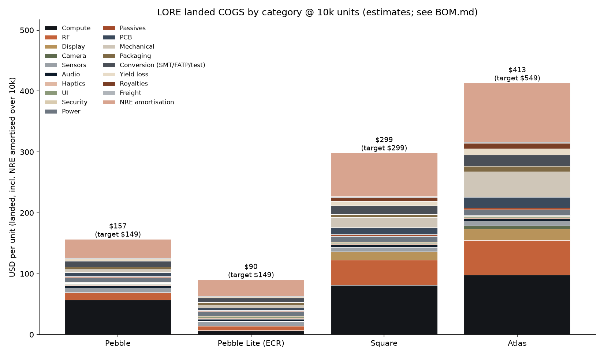
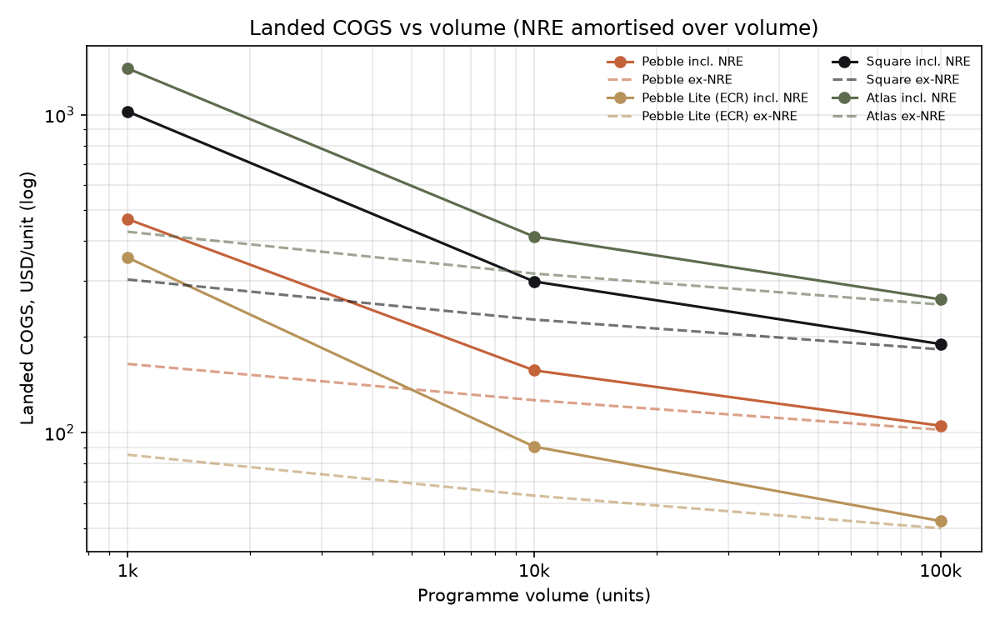

# LORE - Costed Bill of Materials & Landed COGS
_Generated by `build_bom.py` - do not hand-edit; edit the script and re-run._
All prices USD per unit. **Basis:** D = distributor price observed (volume extrapolated), E = engineering estimate (NDA silicon, custom parts, labour; treat as +/-25 %), Q = RFQ pending. Memory lines are priced for the 2026-27 DRAM shortage and are the most volatile items.
## Summary @ 10k units
| SKU | Material | FOB | Landed ex-NRE | Landed incl. NRE | China-FATP scenario | Target price | GM incl. NRE |
|---|---:|---:|---:|---:|---:|---:|---:|
| Pebble | 111.38 | 125.06 | 126.46 | **156.96** | 181.97 | 149 | -5 % |
| Square | 197.68 | 219.11 | 226.71 | **298.71** | 342.53 | 299 | 0 % |
| Atlas | 276.67 | 305.55 | 316.45 | **413.45** | 474.56 | 549 | 25 % |
| Pebble Lite (ECR) | 52.98 | 62.03 | 63.33 | **90.33** | 102.73 | 149 | 39 % |

## Assumptions
* Conversion costs (SMT, FATP, test) are estimates for a Tier-2 Shenzhen/Dongguan EMS or VN/MY site, at 2026 labour rates.
* Yield loss: 1k: 7.0 %, 10k: 3.5 %, 100k: 2.0 % of material+conversion.
* NRE amortised over the tier volume (1k column = true cost of a 1k programme). NRE totals: Pebble cert $165k + tooling $95k + fixtures $45k; Pebble Lite (ECR) cert $140k + tooling $95k + fixtures $35k; Square cert $485k + tooling $140k + fixtures $95k; Atlas cert $640k + tooling $210k + fixtures $120k.
* Base duty case: FATP in Vietnam/Malaysia, 0 % US MFN on HTS 8517.62 (assumed - confirm with customs broker). China-FATP scenario adds 20 % of FOB (assumed Section 301 tiers; source unverified).
* Royalties are estimates: cellular SEPs for LTE Cat-4 IoT-class devices (Qualcomm IoT program publishes 3.5-5 % of module price; other licensors bilateral). Risk: licensors may assert handset/wearable-class rates.
* Not in COGS: warranty reserve (budget 2-3 % of revenue), payment fees, returns, eSIM data (opex, in Finance model), Kickstarter fulfilment.

## Sources
* `genio`: https://www.mediatek.com/press-room/mediatek-unveils-genio-720-and-genio-520-iot-platforms-for-generative-ai-applications
* `genio_long`: https://www.mediatek.com/iot-longevity
* `dram`: https://www.trendforce.com/presscenter/news/20260514-13044.html
* `eg25`: https://uk.rs-online.com/web/p/rf-modules/2069157
* `eg25_sos`: https://www.soselectronic.com/en-us/products/quectel/eg25ggb-256-sgns-308062
* `bg95s5`: https://www.quectel.com/news-and-pr/ces-2025-satellite-communication-module-bg95-s5-skylo-certification/
* `lc29h`: https://quectel.com/content/uploads/sites/3/2022/06/Quectel_LC29H_GNSS_Specification_V1.2.pdf
* `bhi360`: https://www.digikey.fr/en/product-highlight/b/bosch-sensortec/bhi360-programmable-sensor-system
* `bmm350`: https://www.mouser.in/bosch-bmm350-magnetometer/
* `icm45686`: https://www.xonelec.com/mpn/tdk/icm45686
* `oc1230`: https://infineon.com/cms/en/product/security-smart-card-solutions/optiga-embedded-security-solutions/optiga-connect/oc1230/
* `amoled`: https://tailorpixels.com/?p=26783
* `max77654`: https://www.digikey.co.uk/en/products/detail/analog-devices-inc-maxim-integrated/MAX77654AENV-T/17882955
* `ov13b10`: https://www.ovt.com/wp-content/uploads/2023/05/OV13B-PB-v1.2-WEB.pdf
* `btsig`: https://www.bluetooth.com/fee-schedule/
* `qcom_iot_lic`: https://www.qualcomm.com/licensing/cellular-iot-licensing-program
* `sisvel_iot`: https://sisvel.com/insights/cellular-iot-patent-royalties-a-closer-look
* `tariff`: https://goodhopefreight.com/info/logistics-knowledge/us-additional-tariffs-2026.html

---

## Pebble - landed COGS roll-up

| Line | @1k | @10k | @100k |
|---|---:|---:|---:|
| Electronics + mechanical + packaging material | 137.37 | 111.38 | 91.89 |
| SMT | 4.20 | 2.80 | 2.10 |
| FATP labour | 6.00 | 3.90 | 3.00 |
| Test (ICT/FCT/RF cal/IP leak) | 3.60 | 2.40 | 1.70 |
| Programming & key injection | 0.45 | 0.35 | 0.25 |
| Yield loss / scrap | 10.61 | 4.23 | 1.98 |
| **FOB factory** | 162.23 | 125.06 | 100.92 |
| Royalties & licences | 0.00 | 0.00 | 0.00 |
| Freight & insurance to US/EU 3PL | 2.20 | 1.40 | 1.10 |
| **Landed COGS ex-NRE** | 164.43 | 126.46 | 102.02 |
| Certification amortisation | 165.00 | 16.50 | 1.65 |
| Tooling + fixture amortisation | 140.00 | 14.00 | 1.40 |
| **Landed COGS incl. NRE (VN/MY FATP, 0% duty)** | 469.43 | 156.96 | 105.07 |
| Scenario: China FATP (+20% tariff on FOB) | 501.88 | 181.97 | 125.25 |

Target retail $149 -> hardware gross margin @10k on DTC price: **-5 %** incl. NRE, 15 % ex-NRE (before payment fees, returns, warranty, channel margin).

Royalty lines:
* Bluetooth/LC3 (SIG membership covers LC3; no per-unit fee): $0.00
* Optional AAC encoder licence (Via LA) - not in baseline: $0.00
* OS/BSP: AOSP/Yocto - no per-unit fee: $0.00

### Pebble - line items (extended cost)

| Cat | Ref | Description | Mfr | MPN | Qty | $ @1k | $ @10k | $ @100k | Basis | Alternate |
|---|---|---|---|---|---:|---:|---:|---:|:-:|---|
| Compute | U1 | Application SoC, 6 nm, 2xA78+6xA55, 10 TOPS NPU (MT8371) | MediaTek | Genio 520 (MT8371) | 1 | 27.00 | 22.00 | 18.50 | E | Rockchip RK3576 (6 TOPS, LPDDR4X) |
| Compute | U2 | Companion PMIC set per Genio 520 reference design | MediaTek | MT63xx-class PMIC (NDA) | 1 | 4.20 | 3.50 | 2.90 | E |  |
| Compute | U3 | LPDDR5 4 GB (x32, 6400 MT/s) - 1B INT4 LLM + ASR + TTS | Micron / SK hynix / Samsung / CXMT | LPDDR5-4GB-x32 | 1 | 30.00 | 26.00 | 22.00 | E | CXMT LPDDR5 (cost hedge) |
| Compute | U4 | eMMC 5.1 32 GB (OS + 3 City Packs + models) | Kioxia / Samsung / Longsys | eMMC-32GB | 1 | 4.80 | 4.00 | 3.40 | E | UFS 2.2 32GB |
| Compute | U5 | Always-on MCU: sensor hub, buttons, LED ring, power sequencing, BLE beacon | Nordic Semiconductor | nRF54L15-CAAA (WLCSP) | 1 | 2.30 | 1.90 | 1.60 | E | Ambiq Apollo4 Lite |
| RF | U6 | Wi-Fi 6 (1x1) + BT 5.4 dual-mode (BR/EDR A2DP + LE Audio) combo, per Genio ref design | MediaTek | MT79xx combo (e.g. MT7920/MT7921 class) | 1 | 4.80 | 4.00 | 3.40 | E | AzureWave/USI module (EVT only) |
| RF | U7 | 2.4/5 GHz FEM / diplexer | Qorvo / Skyworks | FEM-WiFi6-2G5G | 1 | 0.90 | 0.70 | 0.55 | E |  |
| RF | U8 | GNSS L1+L5 module, GPS/GAL/BDS/QZSS/NavIC, 12.2x16x2.5 mm | Quectel | LC29HAA | 1 | 7.80 | 6.30 | 5.30 | D | u-blox NEO-F10N |
| RF | ANT1-3 | Antennas: GNSS L1/L5 LDS, Wi-Fi/BT LDS on plastic carrier | Pulse / Sunway / Luxshare | LDS custom | 1 | 1.40 | 1.05 | 0.80 | E | FPC antennas |
| Sensors | U20 | 6-axis IMU + programmable fusion MCU (BSX, PDR, step/heading) | Bosch Sensortec | BHI360 | 1 | 4.70 | 3.95 | 3.30 | D | TDK ICM-45686 + host fusion |
| Sensors | U21 | 3-axis magnetometer, +/-2000 uT, 0.1 uT noise-class, I3C/I2C | Bosch Sensortec | BMM350 | 1 | 2.10 | 1.65 | 1.35 | D | MEMSIC MMC5983MA |
| Sensors | U22 | Barometric pressure sensor (floor/look-up, altitude aid) | Bosch Sensortec | BMP390 | 1 | 2.40 | 1.90 | 1.50 | E | Infineon DPS368 |
| Audio | MK1-2 | Digital MEMS mic, PDM, 73 dB SNR, IP57 (beamforming pair) | Infineon | IM73D122V01 | 2 | 2.30 | 1.84 | 1.50 | E | Knowles SPH0690LM4H-1 |
| Audio | U30 | Smart Class-D speaker amp w/ boost + IV-sense speaker protection, I2S/TDM | Texas Instruments | TAS2563YFP | 1 | 1.60 | 1.30 | 1.05 | E | Analog Devices MAX98390 |
| Audio | LS1 | Micro-speaker 1309 box, 8 ohm 0.5 W, IP67 membrane | AAC / Goertek | SPK-1309-custom | 1 | 1.00 | 0.75 | 0.58 | E | Knowles/ Merry |
| Haptics | U31 | Haptic driver, LRA auto-resonance, ROM effects | Texas Instruments | DRV2605LYZFR | 1 | 1.10 | 0.88 | 0.70 | E | Awinic AW86224 |
| Haptics | M1 | X-axis linear resonant actuator 0.8 G, 170 Hz (custom 10x3.5x2.5 mm) | AAC / Jahwa | LRA-X1035-custom | 1 | 1.30 | 0.95 | 0.75 | E | Vybronics VG0832012 |
| UI | U50 | 24-ch constant-current LED driver (8 RGB LEDs ring) | Texas Instruments | LP5024RSMR | 1 | 1.25 | 1.00 | 0.80 | E | Awinic AW20036 |
| UI | LED1-8 | RGB side-view LED 1.0x0.5 mm | Everlight / Kingbright | RGB-0402-SV | 8 | 0.56 | 0.40 | 0.32 | E |  |
| UI | SW1-2 | Tact switch 4 N, 200k cycles (main button + volume rocker) | C&K / Alps | KMR2-class | 2 | 0.28 | 0.22 | 0.18 | E |  |
| Security | U9 | Secure element (device identity, attestation keys, anti-clone) | NXP | SE050E2HQ1 | 1 | 2.10 | 1.70 | 1.35 | E | Infineon OPTIGA Trust M |
| Power | BT1 | Li-ion polymer 650 mAh 3.87 V (2.52 Wh), 4.45 V HV, PCM+NTC, 5.5x35x32 mm | ATL / Sunwoda / SCUD | LP553532-650 | 1 | 3.30 | 2.70 | 2.25 | E | EVE / Desay |
| Power | U41 | Li-ion charger (USB-C 5 V in, I2C, JEITA, ship mode) | Analog Devices | MAX77654AENV+ (charger+3 buck-boost SIMO, rails for MCU/sensors) | 1 | 3.20 | 2.55 | 2.10 | E | SGMicro SGM41511 / Southchip SC8551 |
| Power | U42 | Fuel gauge ModelGauge m5 EZ, internal sense, cycle/age tracking | Analog Devices | MAX17262 | 1 | 1.55 | 1.25 | 1.00 | E | TI BQ27427 |
| Power | J1 | USB-C 16-pin mid-mount receptacle, IPX8-gasketed | Amphenol / Korea Hirose | USB-C-16P-WP | 1 | 0.55 | 0.42 | 0.33 | E | JAE DX07 series |
| Power | D1-4 | ESD/TVS arrays (USB, buttons, pogo) | Nexperia / TI | PESD5V0X1BL / TPD4E05U06 | 4 | 0.32 | 0.24 | 0.20 | E |  |
| Power | J2 | 4-pin magnetic pogo receiver (dock / power-puck) | CFE / Lotes | POGO-4P-1.5mm | 1 | 0.60 | 0.45 | 0.35 | E |  |
| Passives | R/C/L | Passives (~330 pcs, 01005/0201/0402 MLCC, R, ferrite, inductors) | Murata/Samsung EM/Yageo | various | 1 | 2.20 | 1.70 | 1.40 | E |  |
| Passives | Y1-3 | Crystals / TCXO (32.768 kHz, 26 MHz SoC, 38.4 MHz radio) | Epson / NDK / TXC | various | 1 | 0.70 | 0.55 | 0.45 | E |  |
| PCB | PCB1 | Main PCB 8-layer HDI 2+4+2, 36 mm round-square, 0.8 mm, ENEPIG | Unimicron / Zhen Ding / Kinwong / SCC | LORE-PB-MAIN | 1 | 6.00 | 4.40 | 3.40 | E |  |
| PCB | FPC1-2 | Flex: battery/pogo flex, button+LED flex | Career / Flexium / MFLEX | LORE-PB-FPC | 1 | 1.40 | 1.05 | 0.85 | E |  |
| PCB | SH1-3 | Stamped RF shield cans (frame+lid), nickel-silver | Local Shenzhen stamping | SHIELD-PB | 3 | 0.66 | 0.48 | 0.36 | E |  |
| PCB | J3-4 | Board-to-board connectors (battery, FPC) | Panasonic / Hirose | AXE6 / BM28 class | 2 | 0.60 | 0.48 | 0.38 | E |  |
| Mechanical | MEC1 | Top shell PC+30%GF, soft-touch PU paint, Bone/Ink/Terracotta | Tier-1 molder (Dongguan) | LORE-PB-TOP | 1 | 1.60 | 1.10 | 0.80 | E |  |
| Mechanical | MEC2 | Bottom shell PC+GF with pogo bosses & clip rail | Tier-1 molder | LORE-PB-BOT | 1 | 1.20 | 0.85 | 0.62 | E |  |
| Mechanical | MEC3 | LED light-guide ring (PMMA, frosted) + diffuser | Tier-1 molder | LORE-PB-LGR | 1 | 0.55 | 0.38 | 0.28 | E |  |
| Mechanical | MEC4 | Button caps (zinc die-cast, PVD) + rubber keypad | Die-caster | LORE-PB-BTN | 1 | 0.65 | 0.45 | 0.35 | E |  |
| Mechanical | MEC5 | Gaskets, PSA die-cuts, acoustic vents (ePTFE IP67) | Saati / Gore / 3M | various | 1 | 1.10 | 0.85 | 0.68 | E |  |
| Mechanical | MEC6 | Thermal: graphite sheet 40 um + TIM gel | Panasonic PGS / Jones | various | 1 | 0.45 | 0.35 | 0.28 | E |  |
| Mechanical | MEC7 | Detachable spring-steel clip with PC overmould | Stamping + molding | LORE-PB-CLIP | 1 | 0.90 | 0.65 | 0.50 | E |  |
| Mechanical | MEC8 | Screws/inserts/magnets (dock alignment, N52 x2) | various | various | 1 | 0.35 | 0.27 | 0.21 | E |  |
| Packaging | PKG1 | Rigid FSC box with sleeve, moulded-pulp insert | Shenzhen packaging house | LORE-PKG | 1 | 3.20 | 2.40 | 1.85 | E |  |
| Packaging | PKG2 | Quick-start guide, regulatory leaflet, labels | Printer | LORE-QSG | 1 | 0.30 | 0.22 | 0.17 | E |  |
| Packaging | ACC1 | USB-C to USB-C braided 1 m cable (60 W, E-marker-less) | Cable OEM | CBL-C2C-1M | 1 | 1.30 | 1.00 | 0.80 | E |  |
| Packaging | ACC2 | Silicone lanyard loop | Accessory OEM | ACC | 1 | 0.80 | 0.60 | 0.45 | E |  |

---

## Square - landed COGS roll-up

| Line | @1k | @10k | @100k |
|---|---:|---:|---:|
| Electronics + mechanical + packaging material | 254.19 | 197.68 | 161.66 |
| SMT | 6.00 | 4.00 | 3.00 |
| FATP labour | 9.00 | 6.00 | 4.50 |
| Test (ICT/FCT/RF cal/IP leak) | 5.50 | 3.60 | 2.60 |
| Programming & key injection | 0.55 | 0.42 | 0.30 |
| Yield loss / scrap | 19.27 | 7.41 | 3.44 |
| **FOB factory** | 294.51 | 219.11 | 175.50 |
| Royalties & licences | 5.80 | 5.80 | 5.80 |
| Freight & insurance to US/EU 3PL | 2.80 | 1.80 | 1.40 |
| **Landed COGS ex-NRE** | 303.11 | 226.71 | 182.70 |
| Certification amortisation | 485.00 | 48.50 | 4.85 |
| Tooling + fixture amortisation | 235.00 | 23.50 | 2.35 |
| **Landed COGS incl. NRE (VN/MY FATP, 0% duty)** | 1,023.11 | 298.71 | 189.90 |
| Scenario: China FATP (+20% tariff on FOB) | 1,082.01 | 342.53 | 225.00 |

Target retail $299 -> hardware gross margin @10k on DTC price: **0 %** incl. NRE, 24 % ex-NRE (before payment fees, returns, warranty, channel margin).

Royalty lines:
* Cellular LTE Cat-4 SEP stack (Qualcomm IoT program 3.5-5% of module price + Nokia/Ericsson/InterDigital/Huawei etc.; est.): $5.00
* eUICC bootstrap profile + EUM/SM-DS fees (connectivity partner; est.): $0.80
* OS/BSP AOSP - no per-unit fee: $0.00

### Square - line items (extended cost)

| Cat | Ref | Description | Mfr | MPN | Qty | $ @1k | $ @10k | $ @100k | Basis | Alternate |
|---|---|---|---|---|---:|---:|---:|---:|:-:|---|
| Compute | U1 | Application SoC, 6 nm, 2xA78+6xA55, 10 TOPS NPU, Mali GPU (MT8391) | MediaTek | Genio 720 (MT8391) | 1 | 36.00 | 30.00 | 25.50 | E | Qualcomm QCS6490 (12 TOPS) |
| Compute | U2 | Companion PMIC set per Genio 720 reference design (incl. audio codec) | MediaTek | MT63xx-class PMIC (NDA) | 1 | 4.80 | 4.00 | 3.30 | E |  |
| Compute | U3 | LPDDR5 6 GB (x32, 6400 MT/s) - 3B INT4 LLM resident (Linux, not GMS Android) | Micron / SK hynix / Samsung / CXMT | LPDDR5-6GB-x32 | 1 | 46.00 | 38.00 | 32.00 | E | CXMT LPDDR5 |
| Compute | U4 | UFS 2.2 64 GB | Kioxia / Samsung / SK hynix | UFS22-64GB | 1 | 8.50 | 7.20 | 6.20 | E | eMMC 5.1 64GB |
| Compute | U5 | Always-on MCU: sensor hub, crown, buttons, SOS path, power sequencing | Nordic Semiconductor | nRF54L15-CAAA (WLCSP) | 1 | 2.30 | 1.90 | 1.60 | E | Ambiq Apollo4 Lite |
| RF | U6 | LTE Cat-4 global module (FDD/TDD, 3G fallback), LGA 29x32x2.4 mm | Quectel | EG25-G (EG25GGB-256-SGNS) | 1 | 38.00 | 26.00 | 21.00 | D | Quectel EG95-EX/NA regional; chip-down v2 |
| RF | U7 | Consumer eSIM eUICC, GSMA SGP.22, WLCSP 1.8x1.6 mm | Infineon | OPTIGA Connect Consumer OC1230 | 1 | 1.60 | 1.25 | 0.95 | E | Thales/Kigen eUICC; ST ST4SIM (SGP.32) |
| RF | U8 | Wi-Fi 6 + BT 5.4 dual-mode combo (LE Audio, Auracast, A2DP) per Genio ref design | MediaTek | MT79xx combo (MT7920/MT7921 class) | 1 | 4.80 | 4.00 | 3.40 | E | AzureWave module (EVT) |
| RF | U9 | 2.4/5 GHz FEM | Qorvo / Skyworks | FEM-WiFi6-2G5G | 1 | 0.90 | 0.70 | 0.55 | E |  |
| RF | U10 | GNSS L1+L5 module 12.2x16x2.5 mm | Quectel | LC29HAA | 1 | 7.80 | 6.30 | 5.30 | D | u-blox NEO-F10N |
| RF | U11 | LTE antenna aperture tuner SP4T (low-band tuning for metal body) | Infineon | BGSA14GN10 | 1 | 0.65 | 0.50 | 0.40 | E | Qorvo QAT3550 |
| RF | ANT1-4 | Antennas: LTE main (frame slot) + LTE div + GNSS L1/L5 + Wi-Fi/BT (LDS) | Pulse / Sunway / Luxshare | LDS + frame-feed | 1 | 2.60 | 1.95 | 1.50 | E |  |
| RF | J5-8 | Micro-coax + spring contacts for frame antenna feeds | I-PEX / Murata | MHF7S / spring clips | 1 | 0.90 | 0.68 | 0.52 | E |  |
| Sensors | U20 | 6-axis IMU + programmable fusion MCU (BSX, PDR, step/heading) | Bosch Sensortec | BHI360 | 1 | 4.70 | 3.95 | 3.30 | D | TDK ICM-45686 + host fusion |
| Sensors | U21 | 3-axis magnetometer, +/-2000 uT, 0.1 uT noise-class, I3C/I2C | Bosch Sensortec | BMM350 | 1 | 2.10 | 1.65 | 1.35 | D | MEMSIC MMC5983MA |
| Sensors | U22 | Barometric pressure sensor (floor/look-up, altitude aid) | Bosch Sensortec | BMP390 | 1 | 2.40 | 1.90 | 1.50 | E | Infineon DPS368 |
| Audio | MK1-2 | Digital MEMS mic, PDM, 73 dB SNR, IP57 (beamforming pair) | Infineon | IM73D122V01 | 2 | 2.30 | 1.84 | 1.50 | E | Knowles SPH0690LM4H-1 |
| Audio | U30 | Smart Class-D speaker amp w/ boost + IV-sense speaker protection, I2S/TDM | Texas Instruments | TAS2563YFP | 1 | 1.60 | 1.30 | 1.05 | E | Analog Devices MAX98390 |
| Audio | LS1 | Micro-speaker 1511 box, 8 ohm 0.5 W, IP67 membrane | AAC / Goertek | SPK-1511-custom | 1 | 1.00 | 0.75 | 0.58 | E | Knowles/ Merry |
| Haptics | U31 | Haptic driver, LRA auto-resonance, ROM effects | Texas Instruments | DRV2605LYZFR | 1 | 1.10 | 0.88 | 0.70 | E | Awinic AW86224 |
| Haptics | M1 | X-axis linear resonant actuator 0.8 G, 170 Hz (custom 10x3.5x2.5 mm) | AAC / Jahwa | LRA-X1035-custom | 1 | 1.30 | 0.95 | 0.75 | E | Vybronics VG0832012 |
| Display | LCD1 | 1.6in AMOLED 466x466 round-corner, on-cell touch, MIPI-DSI 1-lane / QSPI, AOD, 1000 nit HBM | Visionox / BOE / Tianma | AMOLED-1.60-466-custom (CO5300/RM690B0 DDIC) | 1 | 15.00 | 12.00 | 9.80 | E | 1.43in 466x466 std panel (EVT) |
| Display | CG1 | Cover glass 2.5D aluminosilicate 0.55 mm, AR+AF coat, printed mask | Lens Tech / Biel | CG-SQ-055 | 1 | 2.10 | 1.65 | 1.30 | E | Corning Gorilla / AGC Dragontrail |
| UI | U51 | Optical crown rotation sensor (finger-nav, 0.1 deg-class) | PixArt | PAT9125EL-TKIT | 1 | 1.70 | 1.35 | 1.05 | E | Hall + magnet ring |
| UI | SW1-3 | Tact switches (crown push, main button, SOS) | C&K / Alps | KMR2-class | 3 | 0.42 | 0.33 | 0.27 | E |  |
| Security | U12 | Secure element (device identity, theft-lock, attestation) | NXP | SE050E2HQ1 | 1 | 2.10 | 1.70 | 1.35 | E | Infineon OPTIGA Trust M |
| Power | BT1 | Li-ion polymer 1100 mAh 3.88 V (4.27 Wh), Si-C anode, 4.45 V, 4.0x46x40 mm, PCM+NTC | ATL / Sunwoda / SCUD | LP404640-1100 | 1 | 4.80 | 3.90 | 3.20 | E | EVE / Desay |
| Power | U41 | Li-ion charger (USB-C 5 V in, I2C, JEITA, ship mode) | TI | BQ25620RYKR | 1 | 1.45 | 1.15 | 0.92 | E | SGMicro SGM41511 / Southchip SC8551 |
| Power | U42 | Fuel gauge ModelGauge m5 EZ, internal sense, cycle/age tracking | Analog Devices | MAX17262 | 1 | 1.55 | 1.25 | 1.00 | E | TI BQ27427 |
| Power | J1 | USB-C 16-pin mid-mount receptacle, IPX8-gasketed | Amphenol / Korea Hirose | USB-C-16P-WP | 1 | 0.55 | 0.42 | 0.33 | E | JAE DX07 series |
| Power | D1-4 | ESD/TVS arrays (USB, buttons, pogo) | Nexperia / TI | PESD5V0X1BL / TPD4E05U06 | 4 | 0.32 | 0.24 | 0.20 | E |  |
| Power | J2 | 4-pin magnetic pogo receiver (dock / power-puck) | CFE / Lotes | POGO-4P-1.5mm | 1 | 0.60 | 0.45 | 0.35 | E |  |
| Power | U43 | 3.8 V high-current buck-boost for LTE PA rail (2 A peaks) | Texas Instruments | TPS63810 | 1 | 1.30 | 1.05 | 0.85 | E | Richtek RT6160 |
| Power | U44 | Load switches / LDOs (GNSS, sensors, mic bias) | TI / Torex | TPS22916 / TLV755P | 4 | 0.72 | 0.56 | 0.44 | E |  |
| Passives | R/C/L | Passives (~520 pcs, 01005/0201/0402 MLCC, R, ferrite, inductors) | Murata/Samsung EM/Yageo | various | 1 | 3.10 | 2.40 | 1.95 | E |  |
| Passives | Y1-3 | Crystals / TCXO (32.768 kHz, 26 MHz SoC, 38.4 MHz radio) | Epson / NDK / TXC | various | 1 | 0.70 | 0.55 | 0.45 | E |  |
| PCB | PCB1 | Main PCB 10-layer any-layer HDI, 48x48 mm rounded, 0.8 mm, ENEPIG | Unimicron / Zhen Ding / AT&S | LORE-SQ-MAIN | 1 | 10.50 | 7.40 | 5.80 | E |  |
| PCB | FPC1-4 | Flex: display tail, crown/button flex, battery/pogo flex, antenna feed flex | Career / Flexium / MFLEX | LORE-SQ-FPC | 1 | 2.40 | 1.80 | 1.40 | E |  |
| PCB | SH1-5 | RF shield cans (SoC/DRAM, LTE, Wi-Fi, GNSS, PMIC) | Shenzhen stamping | SHIELD-SQ | 5 | 1.10 | 0.80 | 0.60 | E |  |
| PCB | J3-6 | Board-to-board connectors (display, battery, flexes) | Panasonic / Hirose | A35S / BM28 | 4 | 1.28 | 1.00 | 0.80 | E |  |
| Mechanical | MEC1 | Unibody housing 6013-T6 Al, CNC 5-axis + NMT antenna breaks + anodise (Ink/Sand) + laser | Catcher / Foxconn / BYD Elec / Tongda | LORE-SQ-HSG | 1 | 17.00 | 11.50 | 8.50 | E | Die-cast Al + CNC finish |
| Mechanical | MEC2 | Back cover PC+GF RF-transparent, IMR texture, pogo inserts, laser marking | Tier-1 molder | LORE-SQ-BACK | 1 | 1.50 | 1.05 | 0.80 | E | Zirconia ceramic |
| Mechanical | MEC3 | Crown: 316L SS machined, knurled, with shaft seal | Precision turning | LORE-SQ-CRN | 1 | 1.40 | 1.00 | 0.78 | E |  |
| Mechanical | MEC4 | Button caps 316L SS / Al, terracotta SOS accent | Precision turning | LORE-SQ-BTN | 2 | 0.80 | 0.56 | 0.44 | E |  |
| Mechanical | MEC5 | Gaskets, display PSA, acoustic vents ePTFE (IP67), mid-frame foam | Saati / Gore / 3M | various | 1 | 1.50 | 1.15 | 0.92 | E |  |
| Mechanical | MEC6 | Thermal: Cu foil 50 um + 2x graphite 40 um + TIM gel + vapour-chamber-lite (0.3 mm) | Jones / Auras / Panasonic | various | 1 | 1.60 | 1.20 | 0.95 | E | Graphite-only |
| Mechanical | MEC7 | Mid-frame SUS 0.2 mm stamped (display support, ground) | Stamping | LORE-SQ-MF | 1 | 0.55 | 0.40 | 0.30 | E |  |
| Mechanical | MEC8 | Screws (Torx T2), magnets N52 for dock (x2), lanyard pin | various | various | 1 | 0.40 | 0.30 | 0.24 | E |  |
| Packaging | PKG1 | Rigid FSC box with sleeve, moulded-pulp insert | Shenzhen packaging house | LORE-PKG | 1 | 3.20 | 2.40 | 1.85 | E |  |
| Packaging | PKG2 | Quick-start guide, regulatory leaflet, labels | Printer | LORE-QSG | 1 | 0.30 | 0.22 | 0.17 | E |  |
| Packaging | ACC1 | USB-C to USB-C braided 1 m cable (60 W, E-marker-less) | Cable OEM | CBL-C2C-1M | 1 | 1.30 | 1.00 | 0.80 | E |  |
| Packaging | ACC2 | Leather-look lanyard + quick-release clip | Accessory OEM | ACC | 1 | 1.60 | 1.20 | 0.90 | E |  |

---

## Atlas - landed COGS roll-up

| Line | @1k | @10k | @100k |
|---|---:|---:|---:|
| Electronics + mechanical + packaging material | 360.89 | 276.67 | 223.82 |
| SMT | 7.50 | 5.00 | 3.80 |
| FATP labour | 13.00 | 8.50 | 6.40 |
| Test (ICT/FCT/RF cal/IP leak) | 7.00 | 4.60 | 3.30 |
| Programming & key injection | 0.60 | 0.45 | 0.33 |
| Yield loss / scrap | 27.23 | 10.33 | 4.75 |
| **FOB factory** | 416.22 | 305.55 | 242.40 |
| Royalties & licences | 8.70 | 8.70 | 8.70 |
| Freight & insurance to US/EU 3PL | 3.40 | 2.20 | 1.70 |
| **Landed COGS ex-NRE** | 428.32 | 316.45 | 252.80 |
| Certification amortisation | 640.00 | 64.00 | 6.40 |
| Tooling + fixture amortisation | 330.00 | 33.00 | 3.30 |
| **Landed COGS incl. NRE (VN/MY FATP, 0% duty)** | 1,398.32 | 413.45 | 262.50 |
| Scenario: China FATP (+20% tariff on FOB) | 1,481.56 | 474.56 | 310.98 |

Target retail $549 -> hardware gross margin @10k on DTC price: **25 %** incl. NRE, 42 % ex-NRE (before payment fees, returns, warranty, channel margin).

Royalty lines:
* Cellular LTE Cat-4 + NB-IoT/LTE-M/NTN SEP stack (est.): $6.50
* eUICC bootstrap profile + EUM/SM-DS fees (est.): $0.80
* H.264/HEVC encode (Via LA / Access Advance) for Glance clips (est.): $0.40
* Skylo NTN device activation (est., may be opex): $1.00

### Atlas - line items (extended cost)

| Cat | Ref | Description | Mfr | MPN | Qty | $ @1k | $ @10k | $ @100k | Basis | Alternate |
|---|---|---|---|---|---:|---:|---:|---:|:-:|---|
| Compute | U1 | Application SoC, 6 nm, 2xA78+6xA55, 10 TOPS NPU, Mali GPU (MT8391) | MediaTek | Genio 720 (MT8391) | 1 | 36.00 | 30.00 | 25.50 | E | Qualcomm QCS6490 (12 TOPS) |
| Compute | U2 | Companion PMIC set per Genio 720 reference design (incl. audio codec) | MediaTek | MT63xx-class PMIC (NDA) | 1 | 4.80 | 4.00 | 3.30 | E |  |
| Compute | U3 | LPDDR5 8 GB (x32, 6400 MT/s) - 3-4B INT4 LLM + VLM resident | Micron / SK hynix / Samsung | LPDDR5-8GB-x32 | 1 | 60.00 | 50.00 | 42.00 | E | 12 GB if 4B+VLM concurrency needed |
| Compute | U4 | UFS 3.1 128 GB | Kioxia / Samsung | UFS31-128GB | 1 | 14.00 | 12.00 | 10.30 | E |  |
| Compute | U5 | Always-on MCU: sensor hub, crown, buttons, SOS path, power sequencing | Nordic Semiconductor | nRF54L15-CAAA (WLCSP) | 1 | 2.30 | 1.90 | 1.60 | E | Ambiq Apollo4 Lite |
| RF | U6 | LTE Cat-4 global module (FDD/TDD, 3G fallback), LGA 29x32x2.4 mm | Quectel | EG25-G (EG25GGB-256-SGNS) | 1 | 38.00 | 26.00 | 21.00 | D | Quectel EG95-EX/NA regional; chip-down v2 |
| RF | U7 | Consumer eSIM eUICC, GSMA SGP.22, WLCSP 1.8x1.6 mm | Infineon | OPTIGA Connect Consumer OC1230 | 1 | 1.60 | 1.25 | 0.95 | E | Thales/Kigen eUICC; ST ST4SIM (SGP.32) |
| RF | U8 | Wi-Fi 6 + BT 5.4 dual-mode combo (LE Audio, Auracast, A2DP) per Genio ref design | MediaTek | MT79xx combo (MT7920/MT7921 class) | 1 | 4.80 | 4.00 | 3.40 | E | AzureWave module (EVT) |
| RF | U9 | 2.4/5 GHz FEM | Qorvo / Skyworks | FEM-WiFi6-2G5G | 1 | 0.90 | 0.70 | 0.55 | E |  |
| RF | U10 | GNSS L1+L5 module 12.2x16x2.5 mm | Quectel | LC29HAA | 1 | 7.80 | 6.30 | 5.30 | D | u-blox NEO-F10N |
| RF | U11 | LTE antenna aperture tuner SP4T (low-band tuning for metal body) | Infineon | BGSA14GN10 | 1 | 0.65 | 0.50 | 0.40 | E | Qorvo QAT3550 |
| RF | ANT1-4 | Antennas: LTE main+div (Ti frame segments), GNSS L1/L5, Wi-Fi/BT, NTN L/S-band | Pulse / Sunway / Luxshare | frame-feed + LDS | 1 | 3.60 | 2.70 | 2.10 | E |  |
| RF | J5-8 | Micro-coax + spring contacts for frame antenna feeds | I-PEX / Murata | MHF7S / spring clips | 1 | 0.90 | 0.68 | 0.52 | E |  |
| Sensors | U20 | 6-axis IMU + programmable fusion MCU (BSX, PDR, step/heading) | Bosch Sensortec | BHI360 | 1 | 4.70 | 3.95 | 3.30 | D | TDK ICM-45686 + host fusion |
| Sensors | U21 | 3-axis magnetometer, +/-2000 uT, 0.1 uT noise-class, I3C/I2C | Bosch Sensortec | BMM350 | 1 | 2.10 | 1.65 | 1.35 | D | MEMSIC MMC5983MA |
| Sensors | U22 | Barometric pressure sensor (floor/look-up, altitude aid) | Bosch Sensortec | BMP390 | 1 | 2.40 | 1.90 | 1.50 | E | Infineon DPS368 |
| Audio | MK1-2 | Digital MEMS mic, PDM, 73 dB SNR, IP57 (beamforming pair) | Infineon | IM73D122V01 | 2 | 2.30 | 1.84 | 1.50 | E | Knowles SPH0690LM4H-1 |
| Audio | U30 | Smart Class-D speaker amp w/ boost + IV-sense speaker protection, I2S/TDM | Texas Instruments | TAS2563YFP | 1 | 1.60 | 1.30 | 1.05 | E | Analog Devices MAX98390 |
| Audio | LS1 | Micro-speaker 1511 box, 8 ohm 0.5 W, IP67 membrane | AAC / Goertek | SPK-1511-custom | 1 | 1.00 | 0.75 | 0.58 | E | Knowles/ Merry |
| Haptics | U31 | Haptic driver, LRA auto-resonance, ROM effects | Texas Instruments | DRV2605LYZFR | 1 | 1.10 | 0.88 | 0.70 | E | Awinic AW86224 |
| Haptics | M1 | X-axis linear resonant actuator 0.8 G, 170 Hz (custom 10x3.5x2.5 mm) | AAC / Jahwa | LRA-X1035-custom | 1 | 1.30 | 0.95 | 0.75 | E | Vybronics VG0832012 |
| Display | LCD1 | 1.6in AMOLED 466x466 round-corner, on-cell touch, MIPI-DSI 1-lane / QSPI, AOD, 1000 nit HBM | Visionox / BOE / Tianma | AMOLED-1.60-466-custom (CO5300/RM690B0 DDIC) | 1 | 15.00 | 12.00 | 9.80 | E | 1.43in 466x466 std panel (EVT) |
| Display | CG1 | Sapphire cover 0.7 mm, double-side AR, AF, PVD mask | Biel / Crystal-Optech / Lens Tech | SAP-AT-070 | 1 | 9.00 | 6.50 | 5.00 | E | Aluminosilicate (cost-down) |
| UI | U51 | Optical crown rotation sensor (finger-nav, 0.1 deg-class) | PixArt | PAT9125EL-TKIT | 1 | 1.70 | 1.35 | 1.05 | E | Hall + magnet ring |
| UI | SW1-3 | Tact switches (crown push, main button, SOS) | C&K / Alps | KMR2-class | 3 | 0.42 | 0.33 | 0.27 | E |  |
| Security | U12 | Secure element (device identity, theft-lock, attestation) | NXP | SE050E2HQ1 | 1 | 2.10 | 1.70 | 1.35 | E | Infineon OPTIGA Trust M |
| Power | BT1 | Li-ion polymer 1450 mAh 3.88 V (5.63 Wh), Si-C anode, 5.2x46x40 mm, PCM+NTC | ATL / Sunwoda | LP524640-1450 | 1 | 6.00 | 4.90 | 4.00 | E |  |
| Power | U41 | Li-ion charger (USB-C 5 V in, I2C, JEITA, ship mode) | TI | BQ25620RYKR | 1 | 1.45 | 1.15 | 0.92 | E | SGMicro SGM41511 / Southchip SC8551 |
| Power | U42 | Fuel gauge ModelGauge m5 EZ, internal sense, cycle/age tracking | Analog Devices | MAX17262 | 1 | 1.55 | 1.25 | 1.00 | E | TI BQ27427 |
| Power | J1 | USB-C 16-pin mid-mount receptacle, IPX8-gasketed | Amphenol / Korea Hirose | USB-C-16P-WP | 1 | 0.55 | 0.42 | 0.33 | E | JAE DX07 series |
| Power | D1-4 | ESD/TVS arrays (USB, buttons, pogo) | Nexperia / TI | PESD5V0X1BL / TPD4E05U06 | 4 | 0.32 | 0.24 | 0.20 | E |  |
| Power | J2 | 4-pin magnetic pogo receiver (dock / power-puck) | CFE / Lotes | POGO-4P-1.5mm | 1 | 0.60 | 0.45 | 0.35 | E |  |
| Power | U43 | 3.8 V high-current buck-boost for LTE PA rail (2 A peaks) | Texas Instruments | TPS63810 | 1 | 1.30 | 1.05 | 0.85 | E | Richtek RT6160 |
| Power | U44 | Load switches / LDOs (GNSS, sensors, mic bias) | TI / Torex | TPS22916 / TLV755P | 4 | 0.72 | 0.56 | 0.44 | E |  |
| Passives | R/C/L | Passives (~520 pcs, 01005/0201/0402 MLCC, R, ferrite, inductors) | Murata/Samsung EM/Yageo | various | 1 | 3.10 | 2.40 | 1.95 | E |  |
| Passives | Y1-3 | Crystals / TCXO (32.768 kHz, 26 MHz SoC, 38.4 MHz radio) | Epson / NDK / TXC | various | 1 | 0.70 | 0.55 | 0.45 | E |  |
| PCB | PCB1 | Stacked main board: 2x 10-layer any-layer HDI + interposer (sandwich), 48x48 mm | Unimicron / Zhen Ding / AT&S | LORE-AT-MAIN-STACK | 1 | 19.00 | 13.50 | 10.50 | E | Single board + daughterboard |
| PCB | FPC1-4 | Flex: display tail, crown/button flex, battery/pogo flex, antenna feed flex | Career / Flexium / MFLEX | LORE-SQ-FPC | 1 | 2.40 | 1.80 | 1.40 | E |  |
| PCB | SH1-5 | RF shield cans (SoC/DRAM, LTE, Wi-Fi, GNSS, PMIC) | Shenzhen stamping | SHIELD-SQ | 5 | 1.10 | 0.80 | 0.60 | E |  |
| PCB | J3-6 | Board-to-board connectors (display, battery, flexes) | Panasonic / Hirose | A35S / BM28 | 4 | 1.28 | 1.00 | 0.80 | E |  |
| Mechanical | MEC1 | Housing Ti Gr.5 (Ti-6Al-4V) CNC 5-axis, bead-blast or black DLC, ceramic-filled antenna breaks | Catcher / BYD Elec / Lens Tech | LORE-AT-HSG | 1 | 46.00 | 30.00 | 22.00 | E | Ti Gr.2 (easier machining) / MIM Ti |
| Mechanical | MEC2 | Back cover zirconia ceramic (RF window) with pogo pads + camera bezel | Sinocera / Lens Tech | LORE-AT-BACK | 1 | 5.50 | 4.00 | 3.10 | E | Sapphire back |
| Mechanical | MEC3 | Crown: Ti machined with brass-tone PVD accent ring | Precision turning | LORE-AT-CRN | 1 | 2.80 | 2.00 | 1.55 | E |  |
| Mechanical | MEC4 | Button caps 316L SS / Al, terracotta SOS accent | Precision turning | LORE-SQ-BTN | 2 | 0.80 | 0.56 | 0.44 | E |  |
| Mechanical | MEC5 | Gaskets, display PSA, acoustic vents ePTFE (IP67), mid-frame foam | Saati / Gore / 3M | various | 1 | 1.50 | 1.15 | 0.92 | E |  |
| Mechanical | MEC6 | Thermal: Cu foil 50 um + 2x graphite 40 um + TIM gel + vapour-chamber-lite (0.3 mm) | Jones / Auras / Panasonic | various | 1 | 1.60 | 1.20 | 0.95 | E | Graphite-only |
| Mechanical | MEC7 | Mid-frame SUS 0.2 mm stamped (display support, ground) | Stamping | LORE-SQ-MF | 1 | 0.55 | 0.40 | 0.30 | E |  |
| Mechanical | MEC8 | Screws (Torx T2), magnets N52 for dock (x2), lanyard pin | various | various | 1 | 0.40 | 0.30 | 0.24 | E |  |
| Packaging | PKG1 | Rigid two-piece box, wrapped FSC paper, foil, magnet close | Shenzhen packaging house | LORE-PKG | 1 | 6.50 | 4.80 | 3.80 | E |  |
| Packaging | PKG2 | Quick-start guide, regulatory leaflet, labels | Printer | LORE-QSG | 1 | 0.30 | 0.22 | 0.17 | E |  |
| Packaging | ACC1 | USB-C to USB-C braided 1 m cable (60 W, E-marker-less) | Cable OEM | CBL-C2C-1M | 1 | 1.30 | 1.00 | 0.80 | E |  |
| RF | U13 | 3GPP Rel-17 IoT-NTN module (Skylo-certified) + LTE-M/NB fallback, 23.6x19.9x2.2 mm | Quectel | BG95-S5 | 1 | 19.00 | 14.50 | 11.50 | E | Quectel CC660D-LS (NTN-only) |
| RF | U14 | SPDT RF switch NTN/LTE antenna share | Infineon / pSemi | BGS12P2L6 | 1 | 0.30 | 0.24 | 0.19 | E |  |
| Camera | CAM1 | 13 MP 1/3in 1.12 um 'Glance' camera, fixed-focus wide (~100 deg DFOV) module 6.4x7.2 mm, MIPI CSI-2 4-lane | OmniVision (module: Sunny / Q-Tech / O-Film) | OV13B10 FF module | 1 | 6.20 | 5.10 | 4.30 | E | OmniVision OV08B10 8 MP |
| Camera | CAM2 | Camera window sapphire 4 mm + privacy LED | Biel / Everlight | CAMWIN-AT | 1 | 0.80 | 0.60 | 0.45 | E |  |
| Mechanical | MEC9 | Extra thermal: 0.4 mm Ti-compatible vapour chamber + Cu heat-spreader | Auras / Jones | VC-AT-04 | 1 | 3.20 | 2.40 | 1.90 | E |  |
| Packaging | ACC2 | Full-grain leather lanyard + Ti quick-release + polishing cloth | Accessory OEM | ACC-AT | 1 | 4.00 | 3.00 | 2.30 | E |  |

---

## Pebble Lite (ECR) - landed COGS roll-up

| Line | @1k | @10k | @100k |
|---|---:|---:|---:|
| Electronics + mechanical + packaging material | 67.42 | 52.98 | 42.84 |
| SMT | 2.60 | 1.80 | 1.30 |
| FATP labour | 5.00 | 3.30 | 2.50 |
| Test (ICT/FCT/RF cal/IP leak) | 2.40 | 1.60 | 1.20 |
| Programming & key injection | 0.30 | 0.25 | 0.18 |
| Yield loss / scrap | 5.44 | 2.10 | 0.96 |
| **FOB factory** | 83.16 | 62.03 | 48.98 |
| Royalties & licences | 0.00 | 0.00 | 0.00 |
| Freight & insurance to US/EU 3PL | 2.00 | 1.30 | 1.00 |
| **Landed COGS ex-NRE** | 85.16 | 63.33 | 49.98 |
| Certification amortisation | 140.00 | 14.00 | 1.40 |
| Tooling + fixture amortisation | 130.00 | 13.00 | 1.30 |
| **Landed COGS incl. NRE (VN/MY FATP, 0% duty)** | 355.16 | 90.33 | 52.68 |
| Scenario: China FATP (+20% tariff on FOB) | 371.79 | 102.73 | 62.48 |

Target retail $149 -> hardware gross margin @10k on DTC price: **39 %** incl. NRE, 57 % ex-NRE (before payment fees, returns, warranty, channel margin).

Royalty lines:
* No per-unit royalties in baseline: $0.00

### Pebble Lite (ECR) - line items (extended cost)

| Cat | Ref | Description | Mfr | MPN | Qty | $ @1k | $ @10k | $ @100k | Basis | Alternate |
|---|---|---|---|---|---:|---:|---:|---:|:-:|---|
| RF | U8 | GNSS L1+L5 module, GPS/GAL/BDS/QZSS/NavIC, 12.2x16x2.5 mm | Quectel | LC29HAA | 1 | 7.80 | 6.30 | 5.30 | D | u-blox NEO-F10N |
| RF | ANT1-3 | Antennas: GNSS L1/L5 LDS, Wi-Fi/BT LDS on plastic carrier | Pulse / Sunway / Luxshare | LDS custom | 1 | 1.40 | 1.05 | 0.80 | E | FPC antennas |
| Sensors | U20 | 6-axis IMU + programmable fusion MCU (BSX, PDR, step/heading) | Bosch Sensortec | BHI360 | 1 | 4.70 | 3.95 | 3.30 | D | TDK ICM-45686 + host fusion |
| Sensors | U21 | 3-axis magnetometer, +/-2000 uT, 0.1 uT noise-class, I3C/I2C | Bosch Sensortec | BMM350 | 1 | 2.10 | 1.65 | 1.35 | D | MEMSIC MMC5983MA |
| Sensors | U22 | Barometric pressure sensor (floor/look-up, altitude aid) | Bosch Sensortec | BMP390 | 1 | 2.40 | 1.90 | 1.50 | E | Infineon DPS368 |
| Audio | MK1-2 | Digital MEMS mic, PDM, 73 dB SNR, IP57 (beamforming pair) | Infineon | IM73D122V01 | 2 | 2.30 | 1.84 | 1.50 | E | Knowles SPH0690LM4H-1 |
| Audio | U30 | Smart Class-D speaker amp w/ boost + IV-sense speaker protection, I2S/TDM | Texas Instruments | TAS2563YFP | 1 | 1.60 | 1.30 | 1.05 | E | Analog Devices MAX98390 |
| Audio | LS1 | Micro-speaker 1309 box, 8 ohm 0.5 W, IP67 membrane | AAC / Goertek | SPK-1309-custom | 1 | 1.00 | 0.75 | 0.58 | E | Knowles/ Merry |
| Haptics | U31 | Haptic driver, LRA auto-resonance, ROM effects | Texas Instruments | DRV2605LYZFR | 1 | 1.10 | 0.88 | 0.70 | E | Awinic AW86224 |
| Haptics | M1 | X-axis linear resonant actuator 0.8 G, 170 Hz (custom 10x3.5x2.5 mm) | AAC / Jahwa | LRA-X1035-custom | 1 | 1.30 | 0.95 | 0.75 | E | Vybronics VG0832012 |
| UI | U50 | 24-ch constant-current LED driver (8 RGB LEDs ring) | Texas Instruments | LP5024RSMR | 1 | 1.25 | 1.00 | 0.80 | E | Awinic AW20036 |
| UI | LED1-8 | RGB side-view LED 1.0x0.5 mm | Everlight / Kingbright | RGB-0402-SV | 8 | 0.56 | 0.40 | 0.32 | E |  |
| UI | SW1-2 | Tact switch 4 N, 200k cycles (main button + volume rocker) | C&K / Alps | KMR2-class | 2 | 0.28 | 0.22 | 0.18 | E |  |
| Security | U9 | Secure element (device identity, attestation keys, anti-clone) | NXP | SE050E2HQ1 | 1 | 2.10 | 1.70 | 1.35 | E | Infineon OPTIGA Trust M |
| Power | BT1 | Li-ion polymer 650 mAh 3.87 V (2.52 Wh), 4.45 V HV, PCM+NTC, 5.5x35x32 mm | ATL / Sunwoda / SCUD | LP553532-650 | 1 | 3.30 | 2.70 | 2.25 | E | EVE / Desay |
| Power | U41 | Li-ion charger (USB-C 5 V in, I2C, JEITA, ship mode) | Analog Devices | MAX77654AENV+ (charger+3 buck-boost SIMO, rails for MCU/sensors) | 1 | 3.20 | 2.55 | 2.10 | E | SGMicro SGM41511 / Southchip SC8551 |
| Power | U42 | Fuel gauge ModelGauge m5 EZ, internal sense, cycle/age tracking | Analog Devices | MAX17262 | 1 | 1.55 | 1.25 | 1.00 | E | TI BQ27427 |
| Power | J1 | USB-C 16-pin mid-mount receptacle, IPX8-gasketed | Amphenol / Korea Hirose | USB-C-16P-WP | 1 | 0.55 | 0.42 | 0.33 | E | JAE DX07 series |
| Power | D1-4 | ESD/TVS arrays (USB, buttons, pogo) | Nexperia / TI | PESD5V0X1BL / TPD4E05U06 | 4 | 0.32 | 0.24 | 0.20 | E |  |
| Power | J2 | 4-pin magnetic pogo receiver (dock / power-puck) | CFE / Lotes | POGO-4P-1.5mm | 1 | 0.60 | 0.45 | 0.35 | E |  |
| Passives | Y1-3 | Crystals / TCXO (32.768 kHz, 26 MHz SoC, 38.4 MHz radio) | Epson / NDK / TXC | various | 1 | 0.70 | 0.55 | 0.45 | E |  |
| PCB | FPC1-2 | Flex: battery/pogo flex, button+LED flex | Career / Flexium / MFLEX | LORE-PB-FPC | 1 | 1.40 | 1.05 | 0.85 | E |  |
| PCB | SH1-3 | Stamped RF shield cans (frame+lid), nickel-silver | Local Shenzhen stamping | SHIELD-PB | 3 | 0.66 | 0.48 | 0.36 | E |  |
| PCB | J3-4 | Board-to-board connectors (battery, FPC) | Panasonic / Hirose | AXE6 / BM28 class | 2 | 0.60 | 0.48 | 0.38 | E |  |
| Mechanical | MEC1 | Top shell PC+30%GF, soft-touch PU paint, Bone/Ink/Terracotta | Tier-1 molder (Dongguan) | LORE-PB-TOP | 1 | 1.60 | 1.10 | 0.80 | E |  |
| Mechanical | MEC2 | Bottom shell PC+GF with pogo bosses & clip rail | Tier-1 molder | LORE-PB-BOT | 1 | 1.20 | 0.85 | 0.62 | E |  |
| Mechanical | MEC3 | LED light-guide ring (PMMA, frosted) + diffuser | Tier-1 molder | LORE-PB-LGR | 1 | 0.55 | 0.38 | 0.28 | E |  |
| Mechanical | MEC4 | Button caps (zinc die-cast, PVD) + rubber keypad | Die-caster | LORE-PB-BTN | 1 | 0.65 | 0.45 | 0.35 | E |  |
| Mechanical | MEC5 | Gaskets, PSA die-cuts, acoustic vents (ePTFE IP67) | Saati / Gore / 3M | various | 1 | 1.10 | 0.85 | 0.68 | E |  |
| Mechanical | MEC7 | Detachable spring-steel clip with PC overmould | Stamping + molding | LORE-PB-CLIP | 1 | 0.90 | 0.65 | 0.50 | E |  |
| Mechanical | MEC8 | Screws/inserts/magnets (dock alignment, N52 x2) | various | various | 1 | 0.35 | 0.27 | 0.21 | E |  |
| Packaging | PKG1 | Rigid FSC box with sleeve, moulded-pulp insert | Shenzhen packaging house | LORE-PKG | 1 | 3.20 | 2.40 | 1.85 | E |  |
| Packaging | PKG2 | Quick-start guide, regulatory leaflet, labels | Printer | LORE-QSG | 1 | 0.30 | 0.22 | 0.17 | E |  |
| Packaging | ACC1 | USB-C to USB-C braided 1 m cable (60 W, E-marker-less) | Cable OEM | CBL-C2C-1M | 1 | 1.30 | 1.00 | 0.80 | E |  |
| Packaging | ACC2 | Silicone lanyard loop | Accessory OEM | ACC | 1 | 0.80 | 0.60 | 0.45 | E |  |
| Compute | U1 | Dual-mode BT 5.4 audio SoC (BR/EDR source + LE Audio/Auracast) + DSP, 8 MB flash | Airoha / Bestechnic / Realtek | AB159x / BES27xx / RTL8773 class (source FW) | 1 | 3.80 | 3.10 | 2.60 | E |  |
| Compute | U5 | Host MCU: sensor fusion, offline narration cache, BLE to phone | Nordic Semiconductor | nRF54L15 | 1 | 2.30 | 1.90 | 1.60 | E |  |
| Compute | U4 | QSPI NOR 64 MB (story audio cache, 1 neighbourhood) | Winbond / GigaDevice | W25Q512 class | 1 | 2.20 | 1.80 | 1.50 | E |  |
| Passives | R/C/L | Passives (~180 pcs) | Murata/Samsung EM/Yageo | various | 1 | 1.20 | 0.95 | 0.78 | E |  |
| PCB | PCB1 | Main PCB 6-layer HDI 1+4+1, 36 mm | Kinwong / SCC | LORE-PBL-MAIN | 1 | 3.20 | 2.40 | 1.90 | E |  |

---

## DRAM price sensitivity (@10k)

| SKU | DRAM in BOM | DRAM @ $3.0/GB | Landed ex-NRE (shortage) | Landed ex-NRE (normalised) |
|---|---:|---:|---:|---:|
| Pebble | 26.00 | 12.00 | 126.46 | 111.97 |
| Square | 38.00 | 18.00 | 226.71 | 206.01 |
| Atlas | 50.00 | 24.00 | 316.45 | 289.54 |
| Pebble Lite (ECR) | 0.00 | 0.00 | 63.33 | 63.33 |
