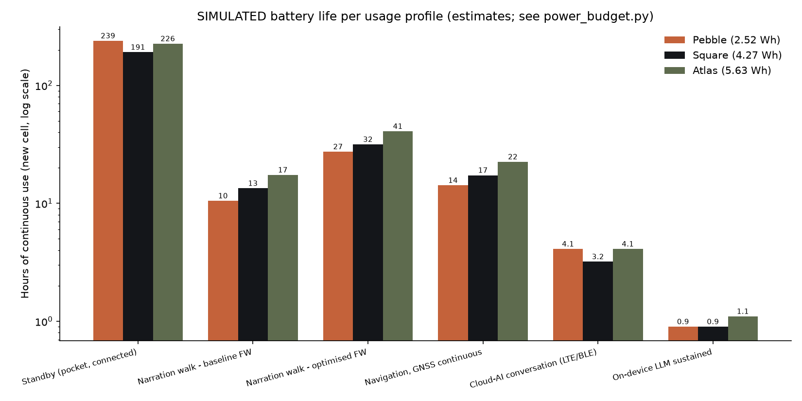
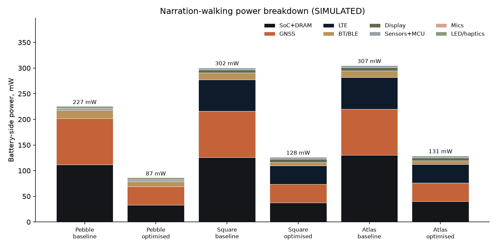
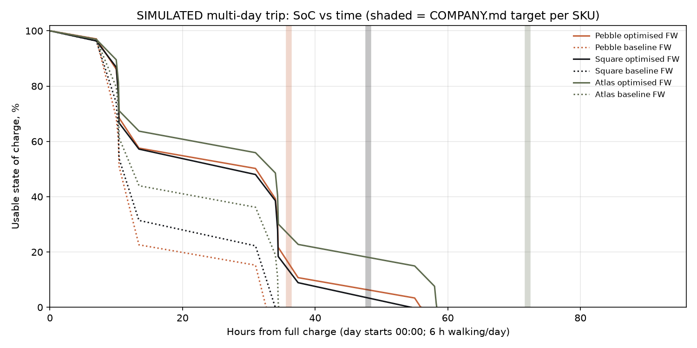
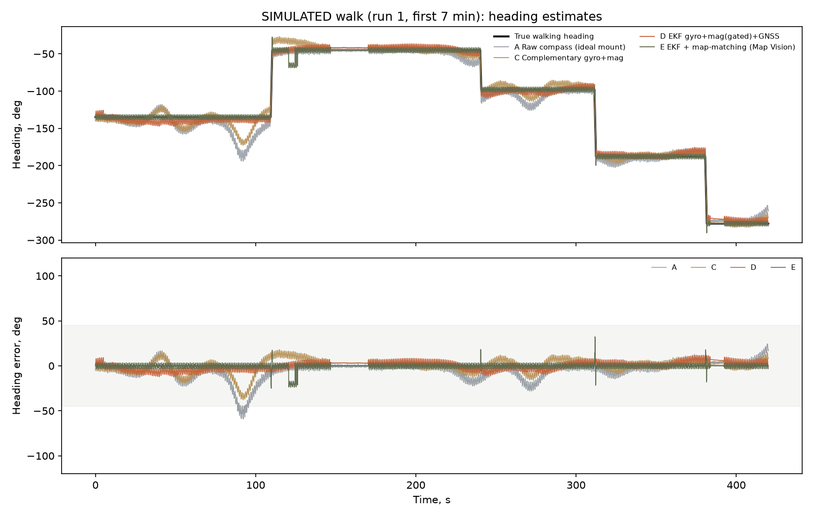
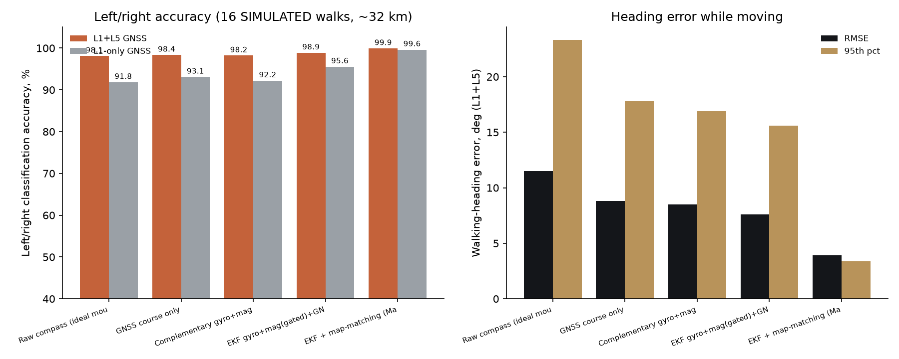
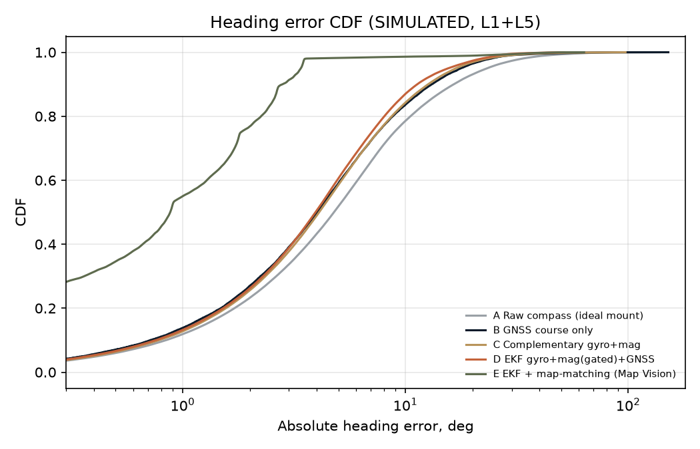
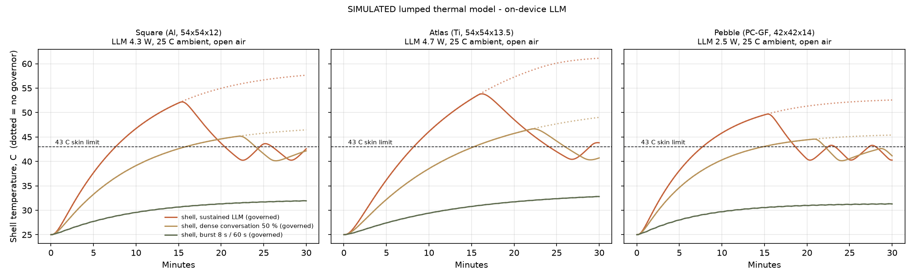
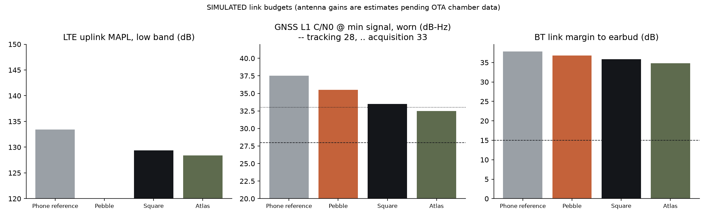

# Simulation results (all SIMULATED; engineering estimates, not measurements)

Every number here comes from the scripts in this folder. Inputs that came from a datasheet are named as such. Everything else is an engineering estimate (E) that must be replaced with bench data at EVT (Q1 2027). Re-run with `python3 <script>.py`.

| Script | What it does | Outputs |
|---|---|---|
| `power_budget.py` | Subsystem power-state model → hours per usage profile and a multi-day trip | `power_profiles.png`, `power_breakdown.png`, `battery_day_curve.png`, `power_results.json` |
| `heading_fusion.py` | Monte-Carlo walker in a disturbed city, comparing 5 heading estimators and scoring left/right | `heading_fusion_trace.png`, `heading_fusion_accuracy.png`, `heading_error_cdf.png`, `heading_results.json` |
| `thermal.py` | 3-node RC thermal model with a skin-temperature governor, for sustained on-device LLM | `thermal_llm.png`, `thermal_results.json` |
| `rf_link_budget.py` | LTE / GNSS / BT / NTN link budgets in Al, Ti and PC bodies | `rf_link_budget.png`, `rf_results.json` |

---

## (a) Power budget and battery life

Cells: Pebble 650 mAh / 2.52 Wh, Square 1100 mAh / 4.27 Wh, Atlas 1450 mAh / 5.63 Wh. Usable energy = 95 % of nameplate. "Aged" = 80 % capacity at about 500 cycles. Conversion efficiency is 88 %.

Datasheet anchors:
- LC29H GNSS: 24 mA @ 3.3 V tracking, 0.7 mA standby, 25 µA backup ([Quectel LC29H spec](https://quectel.com/content/uploads/sites/3/2022/06/Quectel_LC29H_GNSS_Specification_V1.2.pdf)).
- EG25-G LTE: 1.8 mA sleep, 22 mA idle ([EG25-G spec V1.6](https://enpanel.quectel.com/wp-content/uploads/2021/03/Quectel_EG25-G_LTE_Standard_Specification_V1.6-1.pdf)).

SoC, DRAM, display and BT figures are estimates (E).

### Continuous-use hours (new cell)

| Profile | Pebble mW → h | Square mW → h | Atlas mW → h |
|---|---|---|---|
| Standby (pocket, connected; LTE idle on Square/Atlas) | 10 → **239 h** | 21 → **191 h** | 24 → **226 h** |
| Narration walking, baseline FW (GNSS always on, A2DP, AP awake 60 %) | 227 → 10.5 h | 303 → 13.4 h | 307 → 17.4 h |
| Narration walking, optimised FW (GNSS duty 40 % + PDR, LC3, AP awake 15 %) | 87 → **27.4 h** | 128 → **31.6 h** | 131 → **40.8 h** |
| Navigation, GNSS continuous, screen 25 % | 169 → 14.2 h | 234 → 17.3 h | 238 → 22.5 h |
| Cloud-AI conversation (LTE; Pebble via BLE to phone) | 589 → 4.1 h | 1285 → 3.2 h | 1308 → 4.1 h |
| On-device LLM sustained (thermally impossible; see c) | 2519 → 0.9 h | 4379 → 0.9 h | 4834 → 1.1 h |

### "Travel day" multi-day result

The simulated day is: 6 h narration walking, 20 min cloud conversation, 40 on-device LLM answers × 8 s, Atlas 15 Glance captures, and standby for the rest.

| SKU | Target (COMPANY.md) | Baseline FW | Optimised FW (new cell) | Optimised FW (aged cell) | Verdict |
|---|---|---|---|---|---|
| Pebble | 1.5 days | 1.22 days | **2.13 days** | 1.71 days | Meets target **only with optimised FW** |
| Square | 2 days | 1.35 days | **2.07 days** | 1.66 days | Marginal: meets it new, misses it at end of life |
| Atlas | 3 days | 1.65 days | **2.44 days** | 1.95 days | **Misses target.** Needs about 1,800 mAh (≈ 7 Wh) or a lighter usage day |

The two biggest power consumers while walking are **GNSS (L1+L5 ≈ 90 mW continuous)** and **the AP being awake**. The firmware work items in `../firmware-interfaces.md` (GNSS duty-cycling with PDR bridging, the AP suspended between stories, LE Audio LC3) are therefore **hardware-critical, not optional**.

To reach 3 days, Atlas options are:
- (i) a 14.5 mm body with a 1,800 mAh cell;
- (ii) a "3 days" claim defined at 4 h walking per day. That definition gives about 3.0 days and is for Marketing and Founder to decide;
- (iii) a lower-power GNSS (u-blox NEO-F10N ~21 mA @ 3.0 V; small gain).

---

## (b) GNSS + IMU heading fusion and left/right accuracy

16 Monte-Carlo walks of about 2 km each through a simulated Rome-like street network.

Simulated conditions:
- Mounting offset up to ±35°.
- Gyro bias N(0, 0.4°/s).
- Magnetic disturbance patches every ~35 m (median ~6 µT, tails to ~20 µT, against a 25 µT horizontal field).
- Urban-canyon multipath on 45 % of streets.
- POIs every ~22 m, 6–18 m off the centreline, randomly on the left or right. Each is announced 6 m before it is abeam.

| Estimator | Heading RMSE | Median | P95 | Left/right accuracy L1+L5 | Worst run | L1-only accuracy |
|---|---|---|---|---|---|---|
| A Raw compass (given the *true* mounting offset; idealised) | 11.5° | 4.8° | 23.3° | 98.1 % | 92.8 % | 91.8 % |
| B GNSS course only | 8.8° | 4.0° | 17.8° | 98.4 % | 92.8 % | 93.1 % |
| C Complementary gyro+mag | 8.5° | 4.1° | 16.9° | 98.2 % | 92.8 % | 92.2 % |
| D EKF (gyro + gated mag + GNSS course, mount offset estimated) + PDR/GNSS position | 7.6° | 3.9° | 15.6° | 98.9 % | 95.2 % | 95.6 % |
| **E = D + map-matching (Map Vision)** | **3.9°** | **0.9°** | **3.4°** | **99.9 %** | **98.8 %** | **99.6 %** |

The EKF rejected about 38 % of magnetometer updates, using the |B| norm check and a χ² gate. That rejection is what keeps disturbance patches from pulling the heading.

**Takeaways for hardware**
1. Left/right in a city is a **position** problem as much as a heading problem. With a POI 6 m off the centreline, a 6 m lateral GNSS error flips the answer. **L1+L5 lifts every estimator by 3–7 points** over L1-only, which justifies the dual-band GNSS cost (~$6).
2. A raw compass is unacceptable in practice. Even with a perfectly known mounting (which real users never have), its P95 is 23°. Without it, the error equals the unknown mounting offset (up to 35°).
3. Fusing with the map snaps the user to the street and the heading to the street bearing. That turns left/right into a "which way along this street" question and gives **≥ 99.6 % even with L1-only**. Map Vision's quality therefore depends on City Pack geometry quality as much as on sensors.
4. A gyro is required: the EKF and complementary filters both need it, and the BHI360 provides it at about 1 mW.
5. The magnetometer must sit at least 15 mm from the speaker, the LRA and the dock magnets (see schematic sheet 3).

Limitations: the simulation is 2-D and uses a simplified multipath model. Open squares (piazzas) are not modelled, and map-matching is less constraining there. Validate on the Rome pack with a recorded dataset at EVT.

---

## (c) Thermal: sustained on-device LLM

The model is a lumped junction → internal → shell → ambient network, with natural convection and radiation. The skin limit is 43 °C for long-duration body contact (IEC 62368-1 TS1-class; estimate, verify with the safety lab).

| | Square (Al) | Atlas (Ti) | Pebble (PC-GF) |
|---|---|---|---|
| Sustainable power at 43 °C shell, 25 °C ambient, open air | **2.2 W** | 2.0 W | 1.6 W |
| Same, held in hand / in a jacket pocket | 1.8 W / 1.0 W | 1.6 W / 0.9 W | 1.3 W / 0.7 W |
| Same at 35 °C ambient (Rome in July), open air | 1.0 W | 0.9 W | 0.7 W |
| Sustained LLM, no governor: time to 43 °C | 7.6 min (peak 58 °C) | 8.2 min (61 °C) | 7.7 min (53 °C) |
| Burst pattern (8 s answer per minute) | max shell 32 °C, no throttling | 33 °C | 31 °C |

Decode rate estimate: decode is bandwidth-bound, at 25.6 GB/s × 60 %. That gives:

| Model | Estimated decode |
|---|---|
| 1B INT4 | **~24 tok/s** |
| 3B INT4 | **~9 tok/s** |
| 4B INT4 | ~7 tok/s |

Sustained (thermally governed) 3B on the Square is about **4.5 tok/s** in open air at 25 °C.

**Conclusions**
- The product's usage is bursty (20–40 s stories, short Q&A), and that fits the thermal envelope comfortably.
- A **continuous** on-device chat is thermally limited to about 2 W. The governor must step the NPU down, and the software should prefer cloud when LTE is available.
- In a 35 °C summer in a pocket, sustainable power is about 0.5 W. Software must budget for this: shorter answers, cloud fallback, and pre-generated story audio in City Packs (stories are pre-written and checked anyway).
- The Square needs graphite plus Cu foil plus a vapour-chamber-lite spreader (budgeted in the BOM). The Atlas's titanium has poor in-plane conductivity (~7 W/m·K vs ~150 for Al), so it needs a 0.4 mm vapour chamber (budgeted).

---

## (d) Antenna / RF placement and link budget

| Metric | Phone ref. | Pebble | Square (Al + NMT splits) | Atlas (Ti + ceramic back) |
|---|---|---|---|---|
| LTE uplink MAPL, low band | 133.4 dB | – | 129.4 dB | 128.4 dB |
| → cell range vs phone (path-loss exponent 3.5) | 1.00 | – | **0.77** | **0.72** |
| GNSS L1 C/N0 at min signal, worn | 37.5 dB-Hz | 35.5 | 33.5 | 32.5 |
| BT margin to earbud, 1 m through body | 37.8 dB | 36.8 | 35.8 | 34.8 |
| NTN uplink C/N0 (GEO L-band, 38,000 km) | 37.3 dB-Hz | – | – | 34.3 (needs repetitions) |

Thresholds:
- GNSS tracking about 28 dB-Hz; acquisition about 33 dB-Hz.
- Single-tone NB-NTN at 0 dB SNR needs 35.7 dB-Hz. Below that, Rel-17 repetitions trade latency (tens of seconds per SOS message) for coverage. The [Pixel Watch 4 satellite SOS](https://www.androidcentral.com/wearables/google-pixel-watch/google-explains-how-it-got-satellite-sos-on-the-pixel-watch-4) shows that a watch-sized NB-NTN link on Skylo is viable.

Antenna gains are estimates and must be replaced by CTIA OTA chamber TRP/TIS data at EVT.

**Placement rules (input to ID and to pcb-stackup.md)**
1. **The metal body is the antenna.**
   - Square: 6013 Al frame with two NMT (nano-moulded plastic) breaks forms a top slot (LTE main, low band 700–960 MHz with an aperture tuner, Infineon BGSA14GN10) and a bottom slot (LTE diversity plus Wi-Fi/BT).
   - Atlas: Ti frame with ceramic-filled breaks. Ti conductivity is about 3 % of Al, so expect about 1 dB more conductor loss; the ceramic back is the RF window.
2. **GNSS L1/L5 goes on the top edge, facing the sky when clipped to a strap.** Use an LDS antenna on the RF-transparent back-cover carrier, with no metal within 3 mm and the display ground set back 2 mm.
   - Requirement: TIS-equivalent C/N0 ≥ 33 dB-Hz worn.
   - LTE B13/B14 2nd harmonic (~1574–1576 MHz) falls on GPS L1. A desense test and a SAW/notch option are reserved on sheet 2.
3. **Wi-Fi/BT 2.4/5 GHz goes on a side LDS, away from the hand-grip zone.** BT to the earbuds has more than 30 dB margin, so BT is not a risk. Coexistence with LTE B7/B40/B41 is handled by the combo-chip COEX line.
4. **NTN (Atlas)**: the L/S-band share of the LTE main radiator through an SPDT switch (BGS12P2L6). The SOS UX must ask the user to hold the device face-up with a clear sky view.
5. **SAR**: the device is worn on the body and is not at the head. Expect body-worn SAR testing at 5 mm separation (FCC) or 0 mm (CE, for a limb/clip use case). Budget a proximity sensor (capacitive, via the aperture-tuner feed) if SAR margin is tight at EVT.
6. **Diversity**: carriers (notably Verizon) may require RX diversity for Cat-4. It is routed, and a decision on deleting it is gated on the PTCRB/carrier plan (see certification.md).

