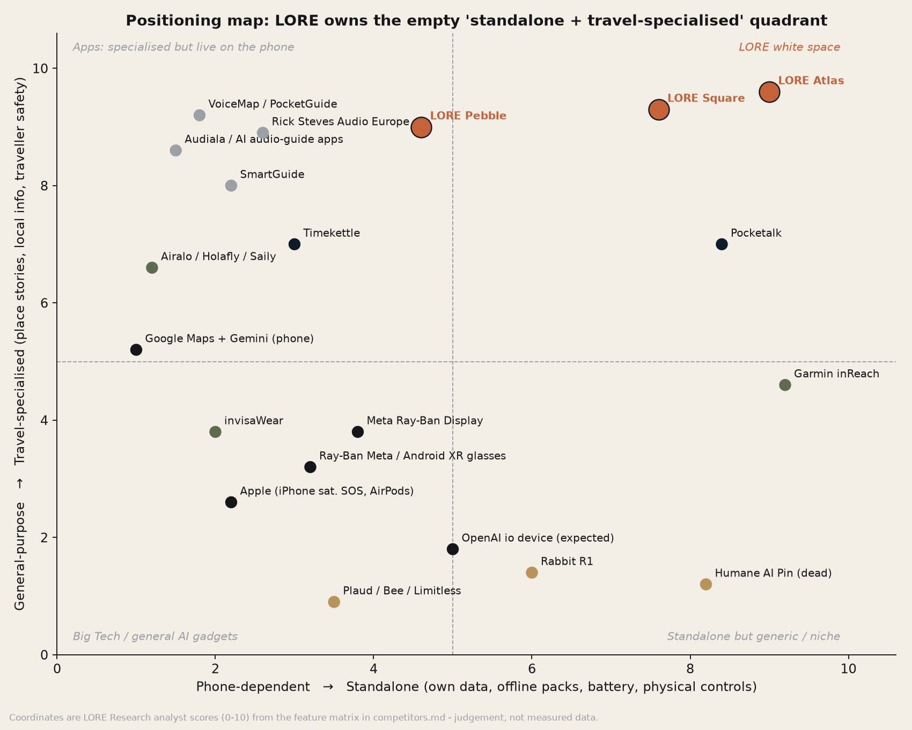

# LORE: Competitive Landscape

*LORE Labs Market Research. Prepared 30 Oct 2026. Prices are USD list/launch prices as reported in the cited sources; sale prices are excluded. "Threat" means the threat to LORE's 2027–2029 plan (1 = low, 5 = existential). Threat scores and positioning coordinates are analyst judgement.*

Charts: [`charts/positioning-map.png`](charts/positioning-map.png) and [`charts/competitor-price-positioning.png`](charts/competitor-price-positioning.png).

---

## 1. Summary: the competitive thesis in five lines

1. **Every capability LORE has exists somewhere already**: AI narration (apps), global data (eSIMs), SOS (Garmin, Apple), translation (Timekettle, Pocketalk), and an AI pocket device (Rabbit, Plaud). **No single product combines them in a standalone, travel-specialised, eyes-up device.** That gap is the top-right quadrant of the map, and it is empty.
2. **The real competitor is "phone + free/cheap app + eSIM"**, not another device. Audiala costs $4.99/month, an Airalo Eurolink 10 GB plan costs $37, and Apple's satellite SOS is free. LORE has to win on *experience* (eyes up, phone safe, battery, offline, verified stories), not on features.
3. **Big Tech AI glasses are the biggest medium-term threat.** EssilorLuxottica sold about 7M Meta smart glasses in 2025. Google and Samsung's Gemini glasses (with Warby Parker and Gentle Monster) arrive in late 2026, and Meta's Ray-Ban Display costs $799. These products have a camera, which gives them real "what am I looking at" vision.
4. **Standalone AI gadgets have a poor record.** Humane is dead (HP bought its assets for $116M), Rabbit has collapsed in usage, and Limitless and Bee were absorbed by Meta and Amazon. The lesson: **a narrow, high-frequency job beats a general assistant.** LORE's job (walking a new city) is narrow, and it is high-frequency *during a trip*, but the device sits idle between trips. That is LORE's core retention risk.
5. **AI audio-guide apps are multiplying** (Guidude, PodWalk, CityTour AI, Hear2GO, Waytale, Zigway, RoadWhisper), mostly as tiny solo-developer launches with near-zero traction. This proves demand for the job and also commoditises "LLM narrates nearby POIs." LORE's moat therefore has to be **verified-fact stories + Map Vision directionality + offline + hardware ergonomics**, not "AI tells you about places."

---

## 2. Feature matrix

Legend: ● = yes / strong · ◐ = partial / limited · ○ = no · ? = not disclosed

| Product | Type | Price (device) | Recurring | Location-triggered stories | Directional ("on your right") | Verified/sourced facts | Offline | Own data (eSIM/LTE) | SOS / safety | Translation | Hands-free / eyes-up | Battery independent of phone | Camera vision |
|---|---|---|---|---|---|---|---|---|---|---|---|---|---|
| **LORE Pebble** | Device | $149 (rec.) | Free tier; Explorer $9.99/mo | ● | ● | ● | ● (packs) | ○ (phone BLE) | ◐ (via phone) | ◐ (cloud) | ● | ◐ (1.5 days; needs phone) | ○ |
| **LORE Square** | Device | $299 (rec.) | as above | ● | ● | ● | ● | ● | ● | ● | ● | ● (2 days) | ○ |
| **LORE Atlas** | Device | $599 (rec.) | as above | ● | ● | ● | ● | ● | ● (+ satellite NTN) | ● | ● | ● (3 days) | ◐ (Glance) |
| Audiala | App | free | $4.99/mo; Trip Pass | ● | ◐ | ? | ◐ | ○ | ○ | ◐ (multi-language) | ◐ | ○ | ◐ (photo recognition) |
| Guidude | App (beta) | free | paid upgrades | ● | ? | ? | ? | ○ | ○ | ? | ◐ | ○ | ○ |
| RoadWhisper | App | free | $2.99/mo | ● (driving) | ? | ○ (LLM + OSM) | ? | ○ | ○ | ● (12–13 languages) | ● | ○ | ○ |
| Hear2GO | App (iPhone) | ? | ? | ● | ? | ○ (LLM + GPS) | ? | ○ | ○ | ? | ◐ | ○ | ○ |
| PodWalk | App | free | per-pass IAP | ● (AI-generated walks) | ◐ | ? | ? | ○ | ○ | ? | ◐ | ○ | ○ |
| CityTour AI | App | free | credits | ● | ◐ | ? | ● (download) | ○ | ○ | ? | ◐ | ○ | ○ |
| GingerGuide | App | ? | ? | ◐ (tap landmark) | ○ | ? | ? | ○ | ○ | ? | ○ | ○ | ○ |
| PocketGuide | App | free | $4.99–14.99 per city/tour | ● | ◐ | ● (human-written) | ● | ○ | ○ | ◐ | ◐ | ○ | ○ |
| SmartGuide | App + B2B | free | premium sub; B2B €25–190/mo | ● | ◐ | ● (author/DMO content) | ● | ○ | ○ | ● | ◐ | ○ | ○ |
| VoiceMap | App | free | $3.99–19.99 per tour; bundles | ● (GPS) | ● (scripted walks) | ● (human authors) | ● | ○ | ○ | ◐ | ● | ○ | ○ |
| Rick Steves Audio Europe | App | free | free | ○ (playlists, not GPS-triggered) | ○ | ● | ● | ○ | ○ | ○ | ● | ○ | ○ |
| Google Maps + Gemini (phone) | Platform | free | free / Gemini sub | ◐ | ◐ | ◐ | ◐ | ○ | ◐ | ● | ○ | ○ | ● (phone camera) |
| Ray-Ban Meta Gen 2 | Glasses | $379 | none | ◐ (ask-to-know) | ○ | ○ | ○ | ○ (phone) | ○ | ● | ● | ◐ | ● |
| Meta Ray-Ban Display | Glasses + band | $799 | none | ◐ | ◐ (display nav) | ○ | ○ | ○ | ○ | ● | ● | ◐ | ● |
| Google/Samsung Android XR glasses | Glasses | not announced | ? | ◐ | ◐ | ○ | ? | ○ | ? | ● | ● | ◐ (up to 9 h) | ● |
| Apple (iPhone + AirPods + Watch Ultra 3) | Ecosystem | $799 (Ultra 3) | free satellite SOS (2 yrs on Ultra 3) | ○ | ○ | ○ | ◐ | ● (cellular watch) | ● (satellite SOS) | ● (AirPods Live Translation; not in EU) | ◐ | ● (watch) | ○ |
| OpenAI × io device | Device (expected) | ? | ? | ? | ? | ? | ? | ? | ? | ● (likely) | ● (screenless) | ? | ? |
| Humane AI Pin | Device (dead) | $699 | $24/mo | ○ | ○ | ○ | ○ | ● | ○ | ● | ● | ● | ● |
| Rabbit R1 | Device | $199 | none | ○ | ○ | ○ | ○ | ◐ (SIM slot) | ○ | ● | ◐ | ● | ● |
| Plaud NotePin S | Recorder | $179 | optional AI plan | ○ | ○ | ○ | ○ | ○ | ○ | ◐ (transcribe) | ● | ● | ○ |
| Limitless Pendant | Recorder (discontinued) | $99–199 | sub | ○ | ○ | ○ | ○ | ○ | ○ | ○ | ● | ● | ○ |
| Bee Pioneer | Wristband (Amazon) | $50 | sub | ○ | ○ | ○ | ○ | ○ | ○ | ○ | ● | ● | ○ |
| Airalo / Holafly / Saily | eSIM | n/a | $20 (5 GB) to $37 (10 GB) / 30 days (Airalo Eurolink) | ○ | ○ | ○ | ○ | ● | ○ | ○ | ○ | ○ | ○ |
| Garmin inReach Mini 3 | Satellite communicator | $449 (Plus $499) | plans ~$14.95–34.95/mo | ○ | ○ | ○ | ● (maps) | ● (satellite) | ● | ○ | ◐ | ● | ○ |
| invisaWear | Safety jewellery | $99–249 | $14.99–19.99/mo | ○ | ○ | ○ | ○ | ○ (phone) | ● (ADT monitored) | ○ | ● | ◐ | ○ |
| Pocketalk Plus | Translator | $299.95 | 2-yr data included | ○ | ○ | ○ | ◐ | ● | ○ | ● | ○ | ● | ● (text) |
| Timekettle W4 Pro | Translator earbuds | $449 launch | none | ○ | ○ | ○ | ◐ | ○ | ○ | ● | ● | ◐ | ○ |

**Read-across:** LORE Square/Atlas is the only product with ● in all of *location-triggered*, *directional*, *verified*, *offline*, *own data* and *SOS*. The nearest single competitor on the "travel job" is **VoiceMap**, which has human-scripted, GPS-triggered directional walks, but it runs on the phone, has no live AI and no safety features. The nearest on the "standalone device" axis is **Pocketalk**, which shows that travellers will pay ~$300 for a single-purpose travel gadget with bundled global data.

---

## 3. Competitor profiles

### 3.1 AI and traditional audio-guide apps

| Competitor | What it is | Pricing | Funding / traction | Strengths | Weaknesses | Threat |
|---|---|---|---|---|---|---|
| **Audiala** (Morges, Switzerland) | "Universal tour guide" AI app with first city free and multi-language narration | Free tier (first city, 3 guides/month); Premium **$4.99/mo**; 7-day Trip Pass; annual plan. https://audiala.com/pricing ; https://audiala.com/ai-facts/ | Funding not disclosed. Third-party estimate under $10k/month iOS revenue (https://appgoblin.info/apps/6446038181), *treat as a rough estimate* | Most polished AI-guide app; Trip Pass model mirrors ours; low price | Phone-bound; no data, safety or offline guarantee; fact-checking not evident | **3** |
| **Guidude** | AI voice tour guide narrating POIs while walking or cycling (iOS, beta) | Free + paid upgrades. https://apps.apple.com/app/id6778813799 | Product Hunt launch with ~7 upvotes; no App Store ratings (https://hunted.space/product/guidude) | Same "walk and listen" job | Very early; no traction | **1** |
| **RoadWhisper** | AI narrator for drives; 12–13 languages, 6 narration styles; OSM + LLM | Freemium, **$2.99/mo** (https://peerpush.com/p/roadwhisper) | Solo developer; ~7 Product Hunt upvotes (https://hunted.space/product/roadwhisper) | Road-trip niche; cheap | LLM-generated (hallucination risk); driving only | **1** |
| **Hear2GO** | iPhone app; LLM + GPS + map data narrating nearby POIs | not disclosed (https://apps.apple.com/app/id6752223086) | n/a | Same concept as Map Vision lite | iPhone-only; no moat | **1** |
| **PodWalk** | AI-generated voiced walking tour "for any place" | Free + per-pass IAP. https://apps.apple.com/app/id6770696805 | n/a | Instant coverage anywhere | Generic content | **1–2** |
| **CityTour AI** | Builds a self-guided route with stops and audio; offline download; Q&A | In-app credits. https://apps.apple.com/cd/app/id6772736527 ; https://www.producthunt.com/products/citytour-ai/makers | n/a | Route + offline | No hardware; small | **1–2** |
| **GingerGuide** | Tap-a-landmark AI travel guide; "hidden gems" map | not found. https://mwm.ai/apps/gingerguide-ai-travel-guide/1354928142 | n/a | Hidden-gem positioning | Map-tap UX (eyes down) | **1** |
| **PocketGuide** | Long-standing GPS audio city guides (human-produced) | Free app; tours/cities **$4.99–14.99** each (e.g., Rome $9.99). https://apps.apple.com/us/app/new-york/id486405766 ; https://adapty.io/paywall-library/pocketguide-audio-travel-guide/ | Mature; undisclosed | Human-quality scripts, offline, big catalogue | Dated UX; per-city paywalls; no AI Q&A | **2** |
| **SmartGuide** (Czech Republic) | Audio-guide platform for destinations, DMOs, attractions + consumer app | Consumer premium subscription; B2B €25–190/month (https://blog.smart-guide.org/pricing-for-tourism-boards ; https://blog.smart-guide.org/pricing-for-attractions) | ~$2.7M total incl. grants and ~$930k crowdfunding (https://www.caplight.com/company/smartguide ; https://travolution.com/news/travel-sectors/tour-and-activities/start-up-smartguide-closes-crowdfunding-bid-after-raising-930000); claims 1.5M+ users | B2B DMO relationships, licensed content, many languages | Content quality uneven; phone-bound | **2** (also a **content partner** candidate) |
| **VoiceMap** (Cape Town) | Marketplace of ~1,300 human-authored GPS walking tours in 500–600 cities | Tours **$3.99–19.99**; creators can set $5.99–29.99; passes and bundle ~$90–99 (https://docs.voicemap.me/tour-publishers/tour-price/ ; https://apps.apple.com/us/app/-/id852027939) | Undisclosed; ~800 publishers | Best-in-class scripted, directional storytelling; strong creator network | Static scripts; phone-bound; no live info or safety | **2** (also a **content-licensing partner** candidate) |
| **Rick Steves Audio Europe** | Free library of Rick Steves self-guided audio tours + radio interviews; offline | **Free** (https://apps.apple.com/us/app/-/id414357125) | Backed by Rick Steves' Europe Inc.; huge US-boomer trust | Brand trust with our secondary persona (culture retirees); offline | Not location-triggered; Europe only; aging | **2** (anchors the "free" reference price for audio content) |

**Historical lesson: Detour (Andrew Mason).** Detour was a premium GPS audio-walk startup that Bose acquired in April 2018. It was shut down on 31 May 2018 because it "was never able to gain a sizable following," and Bose later abandoned its audio-AR platform (https://techcrunch.com/2018/04/24/bose-acquires-andrew-masons-walking-tour-startup-detour ; https://www.afar.com/magazine/our-favorite-walking-tour-app-is-totally-free-through-may-31). **Implication:** premium location audio alone did not build a sustainable consumer business in 2015–2018. LORE has to bundle a utility people need on every trip (data, safety, battery) with the stories.

### 3.2 Big Tech

| Competitor | Status / price | Strengths | Weaknesses vs. LORE | Threat |
|---|---|---|---|---|
| **Meta + EssilorLuxottica** (Ray-Ban Meta Gen 2 $379; Oakley Meta HSTN ~$399–449; **Meta Ray-Ban Display $799** with neural band) | **~7M smart glasses sold in 2025**, more than triple 2024 (https://uploadvr.com/meta-essilorluxottica-sold-7-million-smart-glasses-in-2025/); Display launch price $799 (https://parameter.io/meta-stock-company-launches-799-ray-ban-smart-glasses-with-display); Gen 2 $379 (https://androidcentral.com/wearables/ray-ban-meta-gen-2). Meta also **acquired Limitless** (Dec 2025) (https://www.engadget.com/ai/metas-latest-acquisition-suggests-hardware-plans-beyond-glasses-and-headsets-212930339.html) | Real camera vision ("what is this building?"), distribution, fashion brands, fast improvement | Not travel-specialised; no verified-history engine; needs phone data; prescription friction; battery hours not days; privacy pushback on cameras in museums and churches; Meta AI availability varies by country | **5** |
| **Google + Samsung Android XR / Gemini glasses** (Warby Parker, Gentle Monster frames) | Shown at I/O May 2026; audio-first glasses launching in select markets **fall 2026**; display version demoed; **no price announced**; one camera, up to 9 h use (https://www.thurrott.com/hardware/339507/samsung-details-upcoming-smart-glasses-developed-with-gentle-monster-and-warby-parker ; https://mobilesyrup.com/2026/05/19/samsung-reveals-warby-parker-gentle-monster-android-xr-smartglasses/) | **Google Maps + Places + Gemini Live**: the best POI and navigation graph in the world, delivered to the ear | Generic; Google rarely builds curated, fact-checked narrative content; phone-tethered | **5** |
| **Apple** (iPhone satellite SOS, AirPods Live Translation, Watch Ultra 3 $799) | Free Emergency SOS via satellite extended again (iPhone 14/15) (https://appleinsider.com/articles/25/09/09/iphone-14-and-iphone-15-get-an-extra-year-of-satellite-features-for-free); Watch Ultra 3 with satellite SOS, $799, free for 2 years (https://www.wareable.com/apple/apple-watch-ultra-3-official-announcement-price-features-release-date); AirPods Live Translation **not available to EU users in the EU** (https://mjtsai.com/blog/2025/09/12/) | Commoditises SOS and translation for 1B+ iPhone users at no charge | No storytelling product; ecosystem-locked; EU restrictions | **4** (feature commoditiser) |
| **OpenAI × io (Jony Ive)** | Screenless, pocket-sized, voice-first device; first device "most likely" unveiled H2 2026; production may slip to 2027; reportedly Foxconn-built (https://introl.com/blog/openai-consumer-device-jony-ive-hardware-2026 ; https://www.outlookbusiness.com/artificial-intelligence/openai-teases-pocket-sized-screenless-ai-device-co-designed-with-jony-ive-launches-prototype) | ChatGPT brand (hundreds of millions of users), design pedigree, exactly LORE's form-factor thesis (pocket, screenless, voice) | General-purpose; unlikely to ship global travel eSIM, offline city packs or SOS in v1 | **4–5** (validates the category, and also steals the "pocket AI device" press narrative in 2027) |

### 3.3 AI gadgets

| Competitor | Facts | Lesson for LORE | Threat |
|---|---|---|---|
| **Humane AI Pin** | $699 + $24/mo; ~10k sold against a 100k target; returns exceeded sales in mid-2024 (https://www.macrumors.com/2024/08/07/humane-ai-pin-returns); shut down Feb 2025 and assets sold to HP for $116M (https://www.tomsguide.com/ai/the-humane-ai-pin-is-officially-dead-and-hp-is-picking-up-humanes-leftovers) | Don't try to replace the phone; don't charge a big mandatory subscription; heat, battery and latency kill trust | 1 (dead), but it is the reference **investor objection** |
| **Rabbit R1** | $199 at CES 2024; ~130k units; reports that only ~5k of the first 100k used it daily; payroll delays in 2025 (https://en.wikipedia.org/wiki/Rabbit_r1 ; https://www.tomsguide.com/ai/whats-next-for-rabbit-employees-say-they-havent-been-paid-for-months-while-company-teases-new-ai-hardware) | Hype → sales → abandonment. **Retention metrics must be in the deck.** | 1 |
| **Plaud** (NotePin $159 → NotePin S $179) | >1M devices by mid-2025; ~$250M annualised revenue in 2025; software ARR >$100M; ~25% hardware margin (Sacra) (https://sacra.com/research/250m-year-granola-for-plumbers) | **The success pattern:** one narrow, high-value job, clip-on form factor, hardware + subscription. Pebble should copy Plaud's playbook, not Humane's. | 2 (form-factor and attention competitor) |
| **Limitless Pendant** | $99–199; raised >$33M; acquired by Meta Dec 2025; no longer sold (https://www.engadget.com/ai/metas-latest-acquisition-suggests-hardware-plans-beyond-glasses-and-headsets-212930339.html) | Big Tech buys AI-wearable teams. This is a **possible exit path** for LORE. | 1 |
| **Bee** | $50 wrist device (Pioneer); acquired by Amazon July 2025, terms undisclosed (https://www.etcentric.org/?p=197742) | Amazon is now in ambient AI wearables (Alexa+) | 2 |

### 3.4 Travel eSIMs

| Competitor | Facts | Strengths | Weaknesses | Threat |
|---|---|---|---|---|
| **Airalo** | First eSIM unicorn: $220M round led by CVC at >$1B valuation (Jul 2025); **20M+ users**, 200+ destinations (https://www.airalo.com/about-us/press-releases/airalo-becomes-first-esim-unicorn). Eurolink 10 GB/30 days ≈ $37; 5 GB ≈ $20 (https://esimdb.com/region/europe/airalo) | Price, brand, B2B partner platform (5,000+ partners) | Connectivity only | **3** (substitute for Square's data value) and **partner candidate** for Pebble buyers |
| **Holafly** | Unlimited-data plans; Europe ~$3.90/day to $74.90/30 days (https://saily.com/blog/holafly-esim-pricing/); reported ~$200M revenue in 2024 (Spanish press; https://emprendedores.es/casos-de-exito/holafly-ingresos), *unverified* | Unlimited-data simplicity | Expensive per day | 3 |
| **Saily** (Nord Security) | Launched March 2024, 150+ countries; Europe unlimited from $4.99 claimed (https://nordvpn.com/blog/saily-vs-holafly/) | Nord's marketing machine and security bundle | Connectivity only | 3 |
| **MNOs (from 2026)** | Juniper expects operators to launch their own travel eSIMs from 2026 (https://www.telecoms.com/esim/travel-esim-market-forecasted-to-grow-85-this-year) | Billing relationship | Roaming legacy | 2 |

**Implication.** Travel data is quickly becoming a commodity priced at about $2–4/GB. **LORE should not market Square/Atlas mainly as "data"**. Data is a hygiene feature that makes the device work alone. Our wholesale data cost must sit well below $2/GB for the $29 Trip Pass (5 GB) to carry margin. Hardware team and Finance should confirm IoT/eSIM wholesale (e.g., via Airalo Partners, 1GLOBAL, Truphone or Kigen).

### 3.5 Personal safety

| Competitor | Facts | Threat |
|---|---|---|
| **Garmin inReach** (Mini 2 ~$340–400; Mini 3 **$449**, Mini 3 Plus **$499**) | Satellite messaging + SOS; plans from ~$14.95 (Safety) to ~$34.95/mo (Recreation) + annual fee (https://shopsavvy.com/answers/what-are-the-subscription-costs-for-the-garmin-inreach-mini-2 ; https://www.notebookcheck.net/Garmin-presents-inReach-Mini-3-and-inReach-Mini-3-Plus-with-satellite-messaging-and-modernised-designs.1175419.0.html) | **2** (backcountry, not cities; but it sets the reference that satellite SOS = $450+ with a plan, which supports Atlas pricing) |
| **invisaWear** | Jewellery panic buttons $99–249, ADT-monitored subscription $14.99–19.99/mo; claims 200k+ buyers (https://help.invisawear.com/en-US/how-much-is-the-monthly-fee-170773 ; https://www.newswire.com/news/invisawear-review-2026-what-200-000-buyers-know-about-this-panic-button-jewelry) | **2** (shows women will pay ~$15/mo for monitored safety; US-only monitoring) |
| **Apple satellite SOS** | Free on iPhone 14+ in supported countries; Watch Ultra 3 has 2 years free | **4** (makes "SOS" a weak *headline* benefit; LORE's safety value must be **"walk me home" check-ins + live share + discreet long-press**, not satellite alone) |

### 3.6 Translators

| Competitor | Facts | Threat |
|---|---|---|
| **Pocketalk** (Plus **$299.95**, S2 Plus in Japan ¥32,775 incl. 2-yr data) | Dedicated device with 5-year LTE data in 170+ countries on some SKUs (https://checkout.pocketalk.com/products/pocketalk-plus ; https://kakaku.com/item/K0001710780/) | **2** (but the best **pricing precedent** for Square: a single-purpose travel device + bundled global data at ~$300) |
| **Timekettle W4 / W4 Pro** | W4 Pro launched at **$449** (CES 2025), later $280–290 street; €284–302 in the EU (https://news.talkwithrattan.com/index.php/2025/01/06/timekettle-w4-pro-ai-interpreter-earbuds-launched-at-ces-2025/?amp=1 ; https://aio.lv/en/product--timekettle-6971362040444--11627962.md); Series A 2021 (https://www.cbinsights.com/company/timekettle/financials) | **2** (overlaps LORE Buds' ear real estate; potential integration) |

---

## 4. Threat ranking (top 10)

| Rank | Threat | Why | Mitigation |
|---|---|---|---|
| **1** | **Google/Samsung Gemini glasses + Google Maps** | Google owns the POI graph and Gemini Live; glasses ship fall 2026 at Warby Parker price points | Out-curate them on verified stories (sources shown in-app), Map Vision directionality, offline packs and a 2–3 day battery; **support glasses as an output** (LORE as the travel brain that also speaks through any earbuds or glasses) |
| **2** | **Meta Ray-Ban / Display** | ~7M units a year, camera vision, fashion distribution | Position LORE as "no camera on your face: discreet, respectful in churches and museums, nothing to film strangers"; target non-glasses wearers; integrate as an audio target |
| **3** | **"Phone + AI audio app + eSIM" bundle** (Audiala $4.99 + Airalo $20–37 + free Apple SOS) | Near-zero incremental cost for the user | Lead with the *eyes-up, phone-safe, battery* experience, verified facts, and one-press simplicity; ship a great phone app (the Free tier) as top of funnel; bundle a data allowance so the TCO argument works |
| 4 | OpenAI io device | Steals the "screenless AI companion" narrative and press in 2027 | Stay narrow ("for travellers"); launch City Packs as the content moat; consider an OpenAI-model partnership |
| 5 | Apple ecosystem (SOS, translation, Watch Ultra) | Commoditises safety features | Make safety about *social* features (check-ins, walk-me-home, trusted contacts), not just SOS |
| 6 | eSIM leaders moving into "travel super-apps" | Airalo has 20M users and a B2B partner platform | Partner rather than fight: Airalo/1GLOBAL as wholesale supplier |
| 7 | VoiceMap/PocketGuide content depth | 1,300 human-written tours | License the best tours as "Premium Walks" in LORE |
| 8 | Plaud-style clip-on AI recorders adding travel modes | Same clip-on real estate | Patents and design; Pebble price at or below Plaud ($149 vs $179) |
| 9 | Timekettle/Pocketalk adding guide mode | Travel retail shelf presence | Faster AI roadmap; retail partnerships first |
| 10 | Tour marketplaces (GetYourGuide, Viator) adding AI audio | Distribution to tens of millions of experience buyers | Affiliate partnerships; LORE is a channel for them |

---

## 5. LORE positioning

**Positioning statement (draft for Brand/GTM):**
> *For curious independent travellers who want to experience a new city rather than stare at it through a phone, LORE is a pocket travel companion that tells you the verified stories of the street you are standing on through your own earphones, with its own data, offline maps and a safety button. Unlike AI glasses or guide apps, LORE works for days on one charge, needs no phone in your hand and never makes up history.*

**Where LORE wins (defensible):**
1. **Verified-fact story engine with visible sources.** Competitors either use human scripts (VoiceMap, Rick Steves: accurate but static) or raw LLM output (RoadWhisper, PodWalk, Hear2GO: fluid but hallucination-prone). LORE is the only one positioned as both live *and* sourced.
2. **Map Vision directionality** ("on your right, look up"). Only scripted tours do this today, and only along fixed routes.
3. **Standalone utility bundle**: data + offline + battery + SOS. Each piece exists elsewhere, but not together in a travel-specific product.
4. **No camera (Pebble/Square)**, a privacy advantage in sacred sites, museums and the EU.

**Where LORE is exposed:**
1. Vision: glasses can "see" and LORE infers. Atlas's Glance camera partly closes this gap.
2. Idle time between trips. Mitigate with home-city mode ("tourist in your own city"), a "Weekend Walks" content cadence, and Explorer annual pricing.
3. Carrying one more device and one more charger. Mitigate with a 2–3 day battery, clip form factor and accessories.
4. Cost of content per city. The City Pack pipeline cost must be modelled (Software/Finance).
