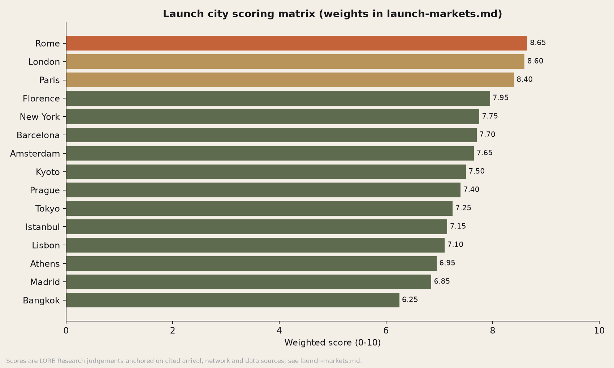

# Launch Markets: City #1 Scoring Matrix

*LORE Labs Market Research. Prepared 30 Oct 2026. Scoring script: [`scripts/make_charts.py`](scripts/make_charts.py) (function `launch_scoring`). Output: [`launch-scoring.csv`](launch-scoring.csv) and [`charts/launch-city-scores.png`](charts/launch-city-scores.png).*

> **Verdict: Rome is confirmed as City #1 (score 8.65/10), but only narrowly ahead of London (8.60) and Paris (8.40).** We recommend keeping Rome for City Pack v1 and the Kickstarter story. We also recommend running **London as the parallel engineering and beta-test city** (English-language, best open data, the founders' and press networks), and making **Florence the cheap "City 1.5"** that reuses the Italian content pipeline.

---

## 1. Criteria and weights

| Criterion | Weight | What it measures | Main evidence |
|---|---|---|---|
| **Tourism volume** | 20% | International visitors per year: the size of the addressable crowd in the city | Euromonitor 2025, city tourism offices |
| **Story density** | 20% | Layers of history per walkable km²: UNESCO cores, "look up" architecture, surprising facts | Analyst judgement; UNESCO listing; heritage databases |
| **Data availability** | 15% | OSM building footprints and entrances, open heritage datasets, Wikidata coverage, English-language sources, licensing | Analyst judgement; Software team to verify |
| **Connectivity** | 10% | Mobile network quality for live AI, and eSIM partner availability | Opensignal, MedUX |
| **Visitor purchasing power & mix** | 15% | Share of high-income US/UK/N-European visitors (our Phase-1 buyers) | National statistics, US outbound data |
| **Solo / walkability / safety need** | 10% | How walkable the city is, its solo-traveller appeal, and how strongly visitors feel the need for safety features (e.g., pickpocket risk) | Hostelworld, pickpocket data, analyst judgement |
| **Operational fit** | 10% | Regulation (CE/RED in the EU; UKCA; Japan TELEC; Turkey IMEI), language, team access, press/creator ecosystem, seasonality | Analyst judgement |

Scores run from 1 to 10 and are **analyst judgements anchored on the data below**. A ±1 change on any single criterion moves a city by at most ±0.2.

## 2. Evidence table

| City | International visitors (latest) | Source | Other notes |
|---|---|---|---|
| **Rome** | 22.9M arrivals in 2025 (Lazio regional count; includes domestic), a record. Plus a record ~33.5M Jubilee pilgrims | https://www.ksl.com/article/51428341/rome-welcomed-record-335-million-pilgrims-for-catholic-holy-year ; https://lepetitjournal.com/rome/actualites/rome-depasse-record-visiteurs-2025-432311 | #4 in the Euromonitor Top 100 City Destinations Index 2025 (https://www.travelmole.com/news/euromonitor-international-top-100-city-destinations-2025). Vatican Museums ~6M/yr. Greater Rome had 33,455 pickpocketing incidents in 2024 (+68% vs 2019). Italy Opensignal: Vodafone 63.8 Mbps average, 216 Mbps 5G (https://insights.opensignal.com/reports/2025/12/italy/mobile-network-experience). Italy is the #1 US study-abroad destination |
| **Paris** | ~18.3M international (Euromonitor 2025); region >23M international | https://pro.visitparisregion.com/presse/presse/communiques-de-presse/communique-de-presse-bilan-annuel-2025-frequentation-touristique-a-paris-ile-de-france ; https://www.thelocal.fr/20260107/paris-landmarks-see-record-tourist-numbers-in-2025 | #1 on the Euromonitor index for the 5th year. Louvre 9M, Eiffel Tower 6.75M |
| **London** | 22.7M international (2025, Euromonitor; #3 globally, #1 in Europe) | https://www.timeout.com/london/news/where-london-ranks-in-the-latest-list-of-the-most-visited-cities-in-the-world-120825 | Ranked worst European city for 5G experience (MedUX) (https://mail.fudzilla.com/news/mobile/60589-london-ranks-last-in-european-5g-race). Strong open data (GLA Datastore); English-language |
| **Barcelona** | Top 10 globally on arrivals in Euromonitor 2025 (exact figure not retrieved; est. ~15–16M) | https://www.timeout.com/asia/news/these-three-asian-cities-ranked-among-the-top-10-city-destinations-in-the-world-in-2025-120925 | Most-booked destination on Booking.com 2025; ~239 thefts a day (2025); tourist-tax increases; anti-tourism protests |
| **Lisbon** | >10M visitors (unofficial, DiscoverCars) | https://greekreporter.com/2026/04/14/athens-top-10-most-tourist-dense-cities/ | Porto/Lisbon among Europe's best 5G (MedUX: Porto 4.78/5) (https://www.advanced-television.com/?p=258427). Overtourism debate |
| **Istanbul** | 19.7M (Euromonitor 2025, +6%); 16.0M foreign visitors Jan–Oct 2025 (official) | https://internationalinvestment.biz/en/tourism/6567-top-tourist-cities-of-2025-new-euromonitor-ranking.html ; https://www.aa.com.tr/en/turkiye/turkiye-attracts-4725m-foreign-tourists-in-january-october/3750006 | Exceptional history; non-EU; lira volatility; device IMEI registration rules for foreign devices on longer stays; lower share of US/UK visitors |
| **Kyoto** | 12.68M foreign visitors (2025, +17%) of 62.8M total | https://www.nippon.com/en/japan-data/h02829/kyoto-tourists-top-60-million-for-first-time-in-2025.html | Lodging tax up to ¥10,000/night from Mar 2026. Japanese radio certification (TELEC/MIC) needed; Japanese-language sources |
| **Tokyo** | Japan total 42.7M (2025); Tokyo city figure not retrieved | https://www.bangladeshmonitor.com.bd/en/japan-welcomes-record-427m-intl-visitors-in-2025 | #3 on the Euromonitor index |
| **New York** | 12.5M international (2025, −3.2%) of ~65M total | https://skift.com/2026/03/24/new-york-city-tourism-ticks-up-but-international-visitors-lag/ | Home market (FCC); huge domestic visitor base; Phase-1 home-city use |
| **Amsterdam** | Not retrieved; estimate ~9–10M international | — (estimate) | City actively discourages mass tourism; excellent open data (Dutch BAG building register) |
| **Prague** | 8.27M guests in 2025 (record, +2.6%), 81% foreign (≈6.7M) | https://praha.eu/web/tourism-unit/statistics-2025 | Compact UNESCO core; high story density |
| **Athens** | ~10.2M international (unofficial); Greece 37.98M (+5.6%) | https://greekreporter.com/2026/04/14/athens-top-10-most-tourist-dense-cities/ ; https://www.euronews.com/2026/02/24/record-arrivals-and-tourism-revenues-for-greece-in-2025 | Strongly seasonal |
| **Florence** | Not retrieved; estimate ~5M+ international | — (estimate) | Highest story density per km²; US students; shares Italian content and partner pipeline with Rome |
| **Madrid** | Not retrieved | — | #2 on the Euromonitor index; lower "story" brand internationally |
| **Bangkok** | **30.3M** (#1 globally, 2025) | https://www.khaosodenglish.com/life/2026/01/03/bangkok-retains-title-as-worlds-most-visited-city-in-2025-with-30-million-visitors/ | Low share of our Phase-1 buyers; less walkable; heat |

## 3. Scoring matrix

| Rank | City | Volume (20%) | Story (20%) | Data (15%) | Conn. (10%) | Purch. power (15%) | Solo/walk (10%) | Ops fit (10%) | **Weighted** |
|---|---|---|---|---|---|---|---|---|---|
| 1 | **Rome** | 9 | 10 | 8 | 7 | 9 | 8 | 8 | **8.65** |
| 2 | London | 9 | 9 | 10 | 6 | 8 | 8 | 9 | **8.60** |
| 3 | Paris | 8 | 9 | 9 | 8 | 9 | 8 | 7 | **8.40** |
| 4 | Florence | 5 | 10 | 8 | 7 | 9 | 9 | 8 | **7.95** |
| 5 | New York | 7 | 7 | 10 | 8 | 7 | 8 | 8 | **7.75** |
| 6 | Barcelona | 8 | 7 | 8 | 8 | 8 | 9 | 6 | **7.70** |
| 7 | Amsterdam | 6 | 7 | 9 | 9 | 8 | 9 | 7 | **7.65** |
| 8 | Kyoto | 7 | 10 | 6 | 9 | 8 | 7 | 4 | **7.50** |
| 9 | Prague | 5 | 9 | 8 | 8 | 6 | 9 | 8 | **7.40** |
| 10 | Tokyo | 8 | 7 | 7 | 9 | 8 | 7 | 4 | **7.25** |
| 11 | Istanbul | 9 | 10 | 6 | 7 | 5 | 6 | 4 | **7.15** |
| 12 | Lisbon | 6 | 7 | 7 | 8 | 7 | 8 | 8 | **7.10** |
| 13 | Athens | 6 | 9 | 6 | 7 | 7 | 6 | 7 | **6.95** |
| 14 | Madrid | 6 | 6 | 8 | 8 | 7 | 7 | 7 | **6.85** |
| 15 | Bangkok | 10 | 6 | 5 | 8 | 4 | 4 | 5 | **6.25** |

**Example of the arithmetic (Rome):** 0.20×9 + 0.20×10 + 0.15×8 + 0.10×7 + 0.15×9 + 0.10×8 + 0.10×8 = 1.8 + 2.0 + 1.2 + 0.7 + 1.35 + 0.8 + 0.8 = **8.65**.

## 4. Where Rome is challenged

1. **The post-Jubilee hangover.** 2025 was inflated by the Holy Year (~33.5M pilgrims). 2026–2027 volumes may normalise downward, and Jubilee pilgrims were not our persona anyway. *Mitigation:* none needed for the scoring, since Rome scores ≥8 on volume even without the Jubilee.
2. **Engineering convenience.** London beats Rome on data availability (English sources, open data) and on operational fit (team and press access). Building Map Vision in Rome means more Italian-language sourcing and fact-checking.
3. **Connectivity.** Italy's networks are good but uneven, with Iliad averaging 37.4 Mbps. Narrow alleys and dense stone buildings in Rome's centro storico are a **GNSS multipath stress test** for Map Vision's "left/right" claims. This is an advantage (if it works in Trastevere, it works anywhere) and a risk for the demo.
4. **Summer heat and seasonality** (July–August): walking tours drop at midday.

## 5. Recommendation

| Role | City | Why |
|---|---|---|
| **City Pack v1 / launch story** | **Rome** | Highest story density, a strong US/UK buyer mix, Italy as the #1 US study-abroad destination, iconic Kickstarter visuals ("the plague hospital on your right"), and a safety story (pickpocketing) |
| **Parallel dev + beta city** | **London** | Best open data, English-language, the team's network, press. Use it to validate Map Vision and the beta (Q1 2027) before the Rome field test |
| **City 1.5 (cheap add-on)** | **Florence** | Reuses the Italian pipeline; high story density per km²; US students |
| **Wave 2 (2028)** | Paris, Barcelona, Amsterdam, Prague, New York (as a home-market city) | Top-scored EU cities plus the US home market |
| **Wave 3 (2028–29)** | Kyoto, Tokyo, Istanbul, Lisbon, Athens | High-story cities with regulatory or language work (JP certification, Turkey IMEI) |
| **Deprioritise** | Bangkok, Madrid | Weak buyer mix or story brand |

**Change vs COMPANY.md "Next" list:** move **London up to beta/parallel**, add **Florence** and **Amsterdam/Prague**, and push **Istanbul and Kyoto later** because of regulation and language. Lisbon scores lower than its "next" slot implies, but it is a good low-cost test market given its 5G quality and compact centre.

**Validation:** survey Q24 (city preference) and interview data will re-weight this matrix in Jan 2027 (hypothesis H9 in [customer-survey.md](customer-survey.md)).
