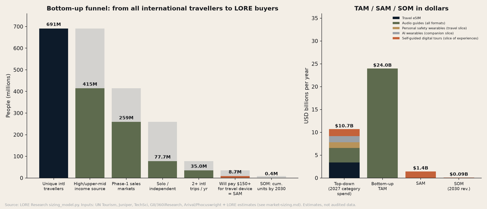

# LORE: Market Sizing (TAM / SAM / SOM)

*LORE Labs Market Research. Prepared 30 Oct 2026. Owner: Head of Market Research.*
*Model: [`scripts/sizing_model.py`](scripts/sizing_model.py), which reproduces every number in this file. Chart: [`charts/market-size-waterfall.png`](charts/market-size-waterfall.png).*

> **How to read this document.** **[SRC]** marks a figure taken from a cited third-party source. **[EST]** marks a LORE Research estimate or assumption, and each one has a validation path in [customer-survey.md](customer-survey.md). Third-party market reports disagree a lot, sometimes by 10x for the same category, so we show ranges and choose the conservative end. Finance owns the operating model. The SOM below is Research's demand-side base case, and Finance should treat it as input, not as a plan.

---

## 0. Headline numbers

| Layer | Definition | Value | Basis |
|---|---|---|---|
| **Top-down TAM (2027)** | 2027 spend in the existing categories whose jobs LORE does: travel eSIM, audio guides, travel-relevant safety wearables, AI companion wearables, self-guided digital tours | **≈ $10.7B / yr** | Category reports × relevant-share estimates (§2) |
| **Bottom-up TAM** | Frequent international travellers (2+ trips a year) from high and upper-middle income markets × LORE annual revenue per user | **≈ $24.0B / yr** (145M people × $165) | §3 |
| **SAM** | Solo or independent, frequent international travellers in the Phase-1 sales markets (US, Canada, UK, EU-27, AU/NZ) who would pay $150+ for a travel device | **≈ 8.7M people ≈ $1.44B / yr** | §4 |
| **SOM (2030, base case)** | Research base-case unit plan: 415k cumulative units by end-2030 (4.7% of SAM people) | **≈ $93M revenue in 2030**; 250k units in 2030 | §5 |

We present the top-down number as the **conservative TAM**. It is the money already being spent today on these jobs. The bottom-up number is the **wallet potential** if frequent travellers adopted a dedicated device. The 2.2x gap between the two is the category-creation opportunity, and it is also the category-creation risk.

---

## 1. Context: the underlying travel volumes [SRC]

| Metric | Value | Source |
|---|---|---|
| International tourist arrivals, 2025 | **≈1.52B** (+4% YoY, ~60M more than 2024) | UN Tourism Barometer, Jan 2026. https://www.untourism.int/news/international-tourist-arrivals-up-4-in-2025-reflecting-strong-travel-demand-around-the-world |
| Europe arrivals, 2025 | 793M (+4% YoY, +6% vs 2019) | same |
| Asia-Pacific arrivals, 2025 | 331M (+6%, still 9% below 2019) | same |
| Americas arrivals, 2025 | 218M (+1%) | same |
| Tourism export revenues, 2025 | $2.2T, of which $1.9T international tourism receipts | https://mexicobusiness.news/trade-and-investment/news/2025-global-tourist-arrivals-4-receipts-hit-us19-trillion |
| UN Tourism outlook 2026 | +3–4% arrivals growth | UN Tourism (above) |
| Top 100 city destinations, 2025 | 702M international arrivals, +8% | Euromonitor via TravelMole. https://www.travelmole.com/news/euromonitor-international-top-100-city-destinations-2025 |
| US citizens overseas air trips, Q3 2025 | 15.4M (+5.3% YoY); 20.2M total by air | NTTO via htrends. https://mobi.htrends.com/?p=140298 |
| Japanese outbound travellers, 2025 | 14.73M | JTTRI/JNTO. https://www.jttri.or.jp/docs/symposium260528-18.pdf |
| US students studying abroad (2023/24) | 298,180 (+6%); Italy is the #1 destination | IIE Open Doors 2025. https://www.iie.org/news/open-doors-2025-press-release/ |

**Solo-travel penetration.** Surveys differ by wording, so we triangulate:

| Survey | Finding | Source |
|---|---|---|
| Skyscanner | 43% of respondents travelled solo in the last year | https://www.skyscanner.com/tips-and-inspiration/solo-travel-statistics |
| Global Rescue (2025) | 35% plan to travel solo in 2025; 60% plan at least one solo trip | https://www.globalrescue.com/common/blog/detail/risk-averse-tech-savvy-travelers-trend/ |
| IMG Travel Outlook 2025 | 48% plan a solo trip during the year | https://www.itij.com/latest/news/img-travel-outlook-survey-predicts-top-destinations-and-travel-trends-2025 |
| ABTA (UK) | 27% plan to travel solo on their next trip | via https://solotravelerworld.com/about/solo-travel-statistics-data/ |
| Hostelworld bookings | Solo share of bookings rose from 57% (2021) to 63% (2024) | https://www.lbc.co.uk/business/695e3eaacae74c418a1ed0ac93bc787f |
| Squaremouth (insurance buyers) | 12% interested in solo travel in 2025 (low outlier; insured-trip sample) | via https://passport-photo.online/blog/solo-travel-statistics |

**Research assumption [EST]: 30% of international travellers take at least one solo or independent (non-packaged) international trip a year.** This sits below the Skyscanner, Global Rescue and IMG figures and above ABTA's "next trip" figure, because "independent" also covers couples travelling without a tour.

---

## 2. Top-down sizing

### 2.1 Category markets [SRC]

| Category | Reported size | Growth | Source | Confidence |
|---|---|---|---|---|
| **Solo travel (total trip spend)** | $482B (2024) to ~$1.07T (2030) | 14.3–14.4% CAGR | TechSci / Grand View via GlobeNewswire. https://www.globenewswire.com/news-release/2025/05/06/3074793/0/en/Solo-Travel-Market-to-Hit-USD-1-07-Trillion-by-2030-Fueled-by-Gen-Z-and-Millennial-Wanderlust.html; Deep Market Insights $495B: https://deepmarketinsights.com/report/solo-travel-market-research-report | Medium. Context only; this is total trip spend, not LORE's wallet |
| **Audio guides: narrow (apps)** | $162M (2024) to $255M (2030) | 7.8% | 360iResearch via GII. https://giiresearch.com/report/ires1676745-audio-tour-guide-app-market-by-tour-type-device.html | Medium |
| **Audio guides: broad (systems + hardware + apps)** | $2.8B (2025) to $5.1B (2034) | 6.9% | Vendor estimate (low confidence); range also includes $2.34B (2024). Listings summarised in search; see also Orbis https://orbisresearch.com/reports/index/global-self-guided-audio-tour-market-research-report-2024 | Low |
| **Museum audio-tour devices** | ~$176M (2024) | 6.7% | 360iResearch via GII. https://cn.gii.tw/report/ires1803629-museum-audio-tour-devices-market-by-device-type.html | Medium |
| **Travel eSIM** | $989M (2024), $1.8B (2025e, +85%), >$8.7B (2030) | 37% implied CAGR 2025–30 | Juniper Research via Telecoms.com. https://www.telecoms.com/esim/travel-esim-market-forecasted-to-grow-85-this-year ; https://telcomagazine.com/news/travel-esim-market-hits-us-1-8bn-in-2025-disrupting-roaming | High (most-cited analyst) |
| **Travel technology (B2B/B2C software)** | $15.5B (2025) to $23.9B (2034) | 5.3% | Market Research Future. https://www.marketresearchfuture.com/reports/travel-technology-market-33880 | Low-medium. Mostly B2B, context only |
| **Online travel (gross)** | $623–713B (2025) | — | IMARC https://www.imarcgroup.com/global-online-travel-market ; GMI https://www.gminsights.com/industry-analysis/online-travel-market | Context only (affiliate pool) |
| **Smart personal safety & security devices** | $12.2B (2024) to $29.7B (2030) | 16% | TechSci. https://www.techsciresearch.com/report/smart-personal-safety-and-security-device-market/21747.html | Medium. Other reports range from $0.76B (tracking only, GIA) to $47B (Market.us) |
| Wearables share of safety devices | >32% | — | Market.us. https://market.us/report/smart-personal-safety-device-market/ | Medium |
| **AI wearables** | $36.4B (2025) to $65.8B (2030) (conservative); range $29.7B–$71.8B for 2025 | 12.5% (cons.) to 35% | 360iResearch via GII https://www.giiresearch.com/report/ires1808490-wearable-ai-market-by-product-type-component.html ; GMI https://www.gminsights.com/toc/detail/wearable-ai-market ; Market.us https://market.us/report/ai-wearable-market/ | Low (definitions include smartwatches and hearables) |
| **Travel experiences (tours, activities, attractions)** | heading to **$342B by 2029** | — | Arival & Phocuswright. https://www.travelweekly.com/Travel-News/Tour-Operators/Travel-experiences-expected-to-surge-to-342B-by-2029 | High (industry standard) |

### 2.2 Top-down TAM build for 2027 (first shipping year)

| Slice | Math | 2027 value |
|---|---|---|
| Travel eSIM (all of it is the "connectivity job") | $1.8B × 1.370² (37.0% CAGR) | **$3.38B** |
| Audio guides, all formats | $2.8B × 1.069² | **$3.20B** |
| Safety wearables, travel slice | $12.2B × 1.16³ = $19.0B × 32% wearables × **20% travel use [EST]** | **$1.22B** |
| AI wearables, pocket-companion slice | $36.38B × 1.1246² = $46.0B × **3% companion/travel use [EST]** | **$1.38B** |
| Self-guided digital tours | **~$300B experiences in 2027 [EST, interpolated toward $342B 2029]** × **0.5% self-guided digital audio/app [EST]** | **$1.50B** |
| **Top-down TAM** | | **$10.68B ≈ $10.7B** |

*Caveat: the slices overlap a little (some audio-guide spend is counted inside experiences), so treat $10.7B as an upper-middle estimate of current-category spend. A "narrow" top-down TAM that uses only audio-guide apps ($0.2B), museum devices ($0.2B) and travel eSIM ($3.4B) is about $3.8B, which is the floor.*

---

## 3. Bottom-up TAM: people × wallet

| Step | Value | Math / basis |
|---|---|---|
| International arrivals, 2025 [SRC] | 1,520M | UN Tourism |
| ÷ arrivals per unique traveller per year [EST] | 2.2 | Multi-trip travellers and multi-country trips (for example, an Interrail trip counts as several arrivals) |
| = Unique international travellers | **≈ 691M** | 1,520 / 2.2 |
| × share from high and upper-middle income source markets [EST] | 60% | Europe alone is 52% of arrivals (793/1,520); add the US, Canada, Japan, Korea, Australia, the GCC and affluent China/India |
| = Addressable-income travellers | **≈ 415M** | |
| × share taking 2+ international trips a year [EST] | 35% | Amex 2025: 59% plan 1–3 international trips (https://www.americanexpress.com/en-us/travel/discover/get-inspired/global-travel-trends-2025); arrivia: 24% of Gen Z take 7+ trips a year (https://resources.arrivia.com/hubfs/Reports/arrivia%20-%20Report%20-%20Loyalty%20and%20the%20Changing%20Traveler%20Q2%202025.pdf) |
| = Frequent international travellers | **≈ 145M** | |
| × annual revenue per user (ARPU) | **$165.17 / yr** | see below |
| **= Bottom-up TAM** | **≈ $24.0B / yr** | 145.1M × $165.17 |

**ARPU build [EST], using Research's recommended prices (see [pricing-research.md](pricing-research.md)):**
- Blended hardware ASP = 45% Pebble × $149 + 40% Square × $299 + 15% Atlas × $599 = **$276.50**. Amortised over a 3-year device life, that is **$92.17/yr**.
- Subscription = 2 trips × $29 Trip Pass, or the equivalent Explorer months = **$58/yr**.
- Accessories + booking-affiliate = **$15/yr**.
- **Total = $165.17 per user-year.**

---

## 4. SAM: who we can actually sell to in 2027–2029

Phase-1 sales markets are the countries with English or EU retail, CE/FCC/UKCA certification that we will already hold, travel eSIM partners, and US/UK/EU press. Japan and India are Phase 2 (see the regional pricing section of [pricing-research.md](pricing-research.md)).

| Step | Value | Basis |
|---|---|---|
| Unique international travellers per year, US | 40M [EST] | NTTO: about 74M US-citizen outbound air departures in 2025 (Q1 16.3M, Q3 20.2M; https://ftnnews.com/travel-news/app/united-states-inbound-air-travel-falls-in-q1-2025/), ÷ ~2 trips per traveller, plus land trips |
| Canada | 12M [EST] | |
| United Kingdom | 45M [EST] | VisitBritain/ONS outbound history is ~85–90M visits abroad a year, ÷ ~2 |
| EU-27 | 150M [EST] | Intra-EU travel dominates the 793M European arrivals |
| Australia + NZ | 12M [EST] | |
| **Pool** | **259M** | |
| × solo/independent share | 30% (§1) → **77.7M** | |
| × 2+ international trips a year | 45% [EST; higher than the TAM's 35% because solo travellers skew younger and more frequent: Hostelworld, arrivia] → **35.0M** | |
| × would pay $150+ for a travel-specific device | 25% [EST; to be validated by survey Q17–Q20] → **8.74M people** | Proxy: Ray-Ban Meta glasses sold 7M units in 2025 (https://uploadvr.com/meta-essilorluxottica-sold-7-million-smart-glasses-in-2025/), which shows a mass market will pay $299–$379 for an AI wearable |
| **SAM value** | 8.74M × $165.17 = **$1.44B / yr** | |
| **SAM, one-time hardware view** | 8.74M × $276.50 = **$2.42B** if every SAM person bought once | |

---

## 5. SOM: obtainable share (Research base case)

The unit assumptions follow the COMPANY.md timeline (Kickstarter Q2 2027, first 5k units Q4 2027, retail + 20 cities in 2028).

| Year | Units shipped | Cum. units | Installed base (3-yr life) | Hardware rev. | Accessories (12% of HW) | Subscriptions (35% attach × $90) | Affiliate ($8 × 70% active) | **Total revenue** | Cum. % of SAM people |
|---|---|---|---|---|---|---|---|---|---|
| 2027 | 5,000 | 5,000 | 5,000 | $1.4M | $0.2M | $0.2M | $0.0M | **$1.7M** | 0.1% |
| 2028 | 40,000 | 45,000 | 45,000 | $11.1M | $1.3M | $1.4M | $0.3M | **$14.1M** | 0.5% |
| 2029 | 120,000 | 165,000 | 165,000 | $33.2M | $4.0M | $5.2M | $0.9M | **$43.3M** | 1.9% |
| **2030** | **250,000** | **415,000** | 410,000 | $69.1M | $8.3M | $12.9M | $2.3M | **$92.6M** | **4.7%** |
| 2031 | 400,000 | 815,000 | 770,000 | $110.6M | $13.3M | $24.3M | $4.3M | **$152.4M** | 9.3% |

Revenue is at **list price**. Kickstarter discounts, retailer margin (30–45%) and returns reduce realised hardware revenue, and we suggest Finance model net ASP at about 80–85% of list for a DTC-heavy mix.

**Scenario range for 2030 (Finance can use these as sensitivity bounds):**
- **Bear (0.5× units: 125k in 2030, ~210k cumulative):** about $46M revenue. This scenario assumes Big Tech glasses and phone AI absorb the "audio guide" job.
- **Base:** about $93M.
- **Bull (1.6× units: 400k in 2030):** about $148M. This scenario assumes retail distribution in travel retail (airports), plus B2B fleets for hostels and tour operators.

**Sanity checks against comparables:**
- Plaud reported more than 1M devices sold by around mid-2025, at a ~$250M annualised revenue run-rate, about 2 years after launch (https://sacra.com/research/250m-year-granola-for-plumbers). That is a category-creation precedent at $159–$179.
- Rabbit R1 sold about 130k units within months at $199, but daily use reportedly collapsed to ~5k of the first 100k buyers (https://en.wikipedia.org/wiki/Rabbit_r1). This is the retention warning.
- Humane sold only about 10k units at $699 + subscription against a target of 100k (https://www.macrumors.com/2024/08/07/humane-ai-pin-returns). This is the price/utility warning.
- Our base case (250k units in 2030, year 4) sits between Humane and Plaud. That is ambitious but not out of line.

---

## 6. Sensitivities (what moves SAM most)

| Assumption | Base | –25% | +25% | SAM people impact |
|---|---|---|---|---|
| Solo/independent share | 30% | 22.5% | 37.5% | 6.6M / 10.9M |
| 2+ trips share | 45% | 33.8% | 56.3% | 6.6M / 10.9M |
| Premium gadget propensity | 25% | 18.8% | 31.3% | 6.6M / 10.9M |
| All three at –25% at once | | | | **3.7M** (bear SAM) |
| All three at +25% at once | | | | **17.1M** (bull SAM) |

The single most uncertain input is **premium-gadget propensity**. That is why the survey's Van Westendorp block (Q17–Q20) and purchase-intent question (Q21) are the gating validation items.

---

## 7. Adjacent revenue pools (upside not in the SOM)

- **Booking affiliate:** online travel is a $623–713B gross market (IMARC, GMI above). At a typical 3–8% affiliate commission on tours and hotels, even $50 of attributable bookings per active user-year would be worth $1.50–4.00 per user. We hold this at $8/active user in the base case.
- **B2B fleet rental** (hostels, tour operators, museums). Museum audio-tour devices alone are ~$176M. SmartGuide sells B2B plans from €25–190/month to attractions, operators and tourism boards (https://blog.smart-guide.org/pricing-for-tourism-boards), which shows B2B willingness to pay.
- **Accessibility edition** (blind and low-vision walkers). Not sized here; it should be scoped with charities and grant bodies in 2028.
