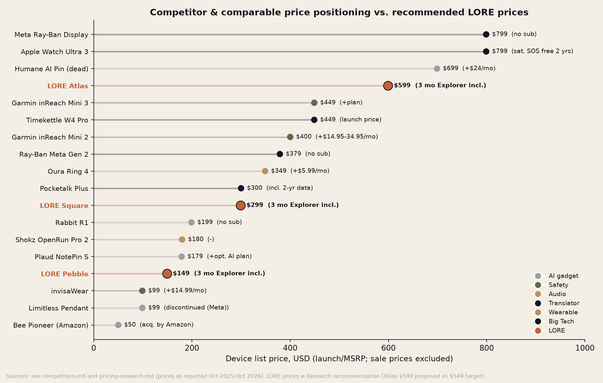

# LORE: Pricing Research

*LORE Labs Market Research. Prepared 30 Oct 2026. All WTP figures in this document are **hypotheses [EST]** until the survey in [customer-survey.md](customer-survey.md) has run (n ≥ 600). Comparable prices are cited list prices. Finance owns margin validation against the Hardware BOM.*

---

## 0. Recommendation summary

| Item | COMPANY.md target | **Research recommendation (US, ex-tax)** | Kickstarter Super Early Bird | Kickstarter Early Bird | Kickstarter standard |
|---|---|---|---|---|---|
| **LORE Pebble** | $149 | **$149** (hold) | **$99** (−34%, first 1,000) | $115 (−23%) | $129 (−13%) |
| **LORE Square** | $299 | **$299** (hold) | **$199** (−33%, first 750) | $229 (−23%) | $259 (−13%) |
| **LORE Atlas** | $549 | **$599** (raise; test $549 vs $599) | **$399** (−33%, first 300) | $449 (−25%) | $499 (−17%) |
| **Explorer** (monthly) | $9.99/mo | **$9.99/mo** (hold) | — | — | — |
| **Explorer annual** (new) | — | **$79/yr** (≈ $6.58/mo, −34%) | Backers get 12 months free (Square/Atlas) or 6 months (Pebble) | | |
| **Trip Pass** 14 days, 5 GB | $29 | **$29** (hold) | | | |
| **Trip Pass Long** 30 days, 10 GB (new) | — | **$49** | | | |
| **Free tier** | 3 cities offline + basic narration | Hold, but make it "**your 3 cities, chosen anytime**" to reduce friction | | | |
| **Bundled with device** | 3 months Explorer | Hold. Make the 3 months start **at first trip activation** (first use abroad), not at unboxing, so the value lands during a trip | | | |

**Why hold Pebble and Square:** both sit at clear psychological reference points set by close comparables. Pebble is below Plaud NotePin S ($179) and Shokz OpenRun Pro 2 ($179.95), and above "impulse" AI gadgets (Bee $50, Limitless $99). Square sits exactly on Pocketalk Plus ($299.95, with 2-year data) and below Ray-Ban Meta Gen 2 ($379).

**Why raise Atlas to $599:** Atlas's reference set is premium: Garmin inReach Mini 3 Plus ($499) for satellite SOS alone, Apple Watch Ultra 3 ($799) and Meta Ray-Ban Display ($799). Titanium, sapphire, an NTN satellite modem and a camera carry a materially higher BOM. A $300 step from Square to Atlas ($299 → $599 = 2.0×) makes a cleaner good/better/best ladder than $250 (1.84×). And for "quiet luxury" buyers (Leica/Aesop codes), a too-low price undermines credibility. **Condition:** if the Van Westendorp "too cheap" threshold for Atlas comes in below $450, or if the $599 cell's purchase intent is more than 20% lower relative to the $549 cell, revert to $549.

---

## 1. Comparable price set

### 1.1 Hardware

| Product | Price (USD) | Recurring | Relevance | Source |
|---|---|---|---|---|
| Bee Pioneer | $50 | sub | Low-end AI wearable | https://www.etcentric.org/?p=197742 |
| Limitless Pendant | $99–199 (sources conflict) | sub | AI pendant | https://www.engadget.com/ai/metas-latest-acquisition-suggests-hardware-plans-beyond-glasses-and-headsets-212930339.html |
| invisaWear | $99–249 | $14.99–19.99/mo | Safety wearable | https://help.invisawear.com/en-US/how-much-is-the-monthly-fee-170773 |
| Plaud NotePin / NotePin S | $159 / $179 | optional AI plan | **Pebble's closest form-factor comp** | https://aiwiki.ai/wiki/plaud_ai |
| Shokz OpenRun Pro 2 | $179.95 | — | LORE Buds comp | https://www.techradar.com/health-fitness/fitness-headphones/shokz-openrun-pro-2-review-the-ideal-runners-headphones |
| Rabbit R1 | $199 | none | AI pocket device | https://en.wikipedia.org/wiki/Rabbit_r1 |
| Pocketalk Plus | $299.95 | 2-yr data incl. | **Square's closest price/value comp** | https://checkout.pocketalk.com/products/pocketalk-plus |
| Oura Ring 4 | $349 (Ring 5 from $399) | $5.99/mo or $69.99/yr | Premium wearable + subscription norm | https://www.techradar.com/health-fitness/oura-ring-4-review ; https://lifestack.ai/blog/oura-ring-pricing |
| Ray-Ban Meta Gen 2 | $379 | none | Big Tech AI wearable | https://androidcentral.com/wearables/ray-ban-meta-gen-2 |
| Garmin inReach Mini 2 | ~$340–400 | $14.95–34.95/mo | Satellite SOS | https://shopsavvy.com/answers/what-are-the-subscription-costs-for-the-garmin-inreach-mini-2 |
| Garmin inReach Mini 3 / Plus | $449 / $499 | plan | **Atlas safety-anchor comp** | https://www.notebookcheck.net/Garmin-presents-inReach-Mini-3-and-inReach-Mini-3-Plus-with-satellite-messaging-and-modernised-designs.1175419.0.html |
| Timekettle W4 Pro | $449 at launch (street ~$280–290) | none | Travel AI earbuds | https://news.talkwithrattan.com/index.php/2025/01/06/timekettle-w4-pro-ai-interpreter-earbuds-launched-at-ces-2025/?amp=1 |
| Humane AI Pin | $699 | $24/mo | **Failure anchor** | https://www.macrumors.com/2024/08/07/humane-ai-pin-returns |
| Apple Watch Ultra 3 | $799 | sat. SOS free 2 yrs | **Atlas premium anchor** | https://www.wareable.com/apple/apple-watch-ultra-3-official-announcement-price-features-release-date |
| Meta Ray-Ban Display | $799 | none | Premium AI wearable | https://parameter.io/meta-stock-company-launches-799-ray-ban-smart-glasses-with-display |

### 1.2 Content and connectivity (what the subscription competes with)

| Product | Price | Source |
|---|---|---|
| Audiala Premium | $4.99/mo; 7-day Trip Pass | https://audiala.com/pricing |
| RoadWhisper premium | $2.99/mo | https://peerpush.com/p/roadwhisper |
| PocketGuide city/tour | $4.99–14.99 each (Rome $9.99) | https://apps.apple.com/us/app/new-york/id486405766 |
| VoiceMap single tour | $3.99–19.99 | https://docs.voicemap.me/tour-publishers/tour-price/ |
| Rick Steves Audio Europe | free | https://apps.apple.com/us/app/-/id414357125 |
| Vatican Museums third-party audio tour (no ticket) | from ~$8 | https://www.tiqets.com/en/vatican-museums-audio-guide-vatican-museums-b257738 |
| Colosseum third-party audio tour (no ticket) | from ~$6 | https://magpie.travel/things-to-do/colosseum-self-guided-audio-tour-no-entrance-ticket/80139d77-bab8-4524-a18e-219e2a7565d6 |
| Airalo Eurolink 5 GB / 10 GB, 30 days | ~$20 / ~$37 | https://esimdb.com/region/europe/airalo ; https://www.phonetravelwiz.com/airalo-eurolink-italy-esim-review |
| Airalo Italy-only 10 GB | ~$19–24 | https://esimdb.com/italy/airalo |
| Holafly Europe unlimited | $3.90/day to $74.90/30 days | https://saily.com/blog/holafly-esim-pricing/ |
| invisaWear monitored safety | $14.99–19.99/mo | (above) |
| Garmin inReach Safety plan | ~$14.95/mo | (above) |

### 1.3 Value-stack check for Trip Pass ($29 / 14 days / 5 GB)

What a Rome trip would cost if bought separately (estimate, using the comparables above):

| Component | Separate purchase |
|---|---|
| 5 GB EU data (Airalo Eurolink) | ~$20 |
| Two attraction audio guides (Colosseum + Vatican, third-party) | ~$14 |
| AI city guide app for 2 weeks (Audiala Trip Pass / monthly) | ~$5 |
| Monitored safety for 2 weeks (invisaWear-equivalent) | ~$7.50 |
| **Total** | **≈ $46.50** |

At $29, the Trip Pass is about 38% cheaper than the stack. That is a clear value message ("everything for your trip, one price"). **Margin warning:** if wholesale data costs $1.50/GB, 5 GB costs $7.50 against $29 revenue, before LLM inference and store fees (15–30% if sold in-app). Sell Trip Passes on the web/device, not through app-store IAP, wherever store rules allow.

---

## 2. Van Westendorp Price Sensitivity Meter: framework

### 2.1 The four questions (asked per SKU after a 30-second concept video and spec card)

1. At what price would you consider **[product] so expensive that you would not consider buying it?** (Too expensive)
2. At what price would you consider it **priced so low that you would question its quality?** (Too cheap)
3. At what price would you consider it **starting to get expensive, so that it is not out of the question but you would have to give some thought to buying it?** (Expensive / "getting expensive")
4. At what price would you consider it **a bargain, a great buy for the money?** (Cheap / bargain)

Follow-up (Newton–Miller–Smith extension): **"At the price you said was a bargain/getting expensive, how likely are you to buy in the next 12 months?"** (5-point scale). This gives calibrated purchase probability and a revenue-maximising price.

### 2.2 Analysis

- Plot cumulative distributions: "too cheap" and "bargain" as descending curves, "getting expensive" and "too expensive" as ascending.
- **Point of Marginal Cheapness (PMC)** = too cheap × not-a-bargain intersection.
- **Point of Marginal Expensiveness (PME)** = too expensive × not-expensive intersection.
- **Optimal Price Point (OPP)** = too cheap × too expensive.
- **Indifference Price Point (IPP)** = bargain × getting-expensive.
- **Acceptable range** = PMC to PME. **Decision rule:** the list price must sit inside the acceptable range for the **primary persona** (solo traveller, 22–45, 2+ international trips a year) and should sit at or above the IPP for Atlas (premium) and at or below the IPP for Pebble (volume).
- Segment cuts: persona, region (US/UK/EU), gender (safety value), income band, current eSIM user vs roamer, glasses wearer vs not.
- Run alongside a **Gabor–Granger** monadic test (randomised single price per respondent: Atlas $499/$549/$599/$649; Square $249/$299/$349) and a **choice-based conjoint** (CBC) on: device tier × price × subscription model (included months: 3/6/12) × data included (0/1/5 GB) × safety (none/SOS/SOS+monitored).

### 2.3 Willingness-to-pay hypotheses [EST, to be validated]

| SKU | PMC (too cheap) | IPP | OPP | PME (too expensive) | Hypothesised acceptable range | Recommended price position |
|---|---|---|---|---|---|---|
| Pebble | $79 | $139 | $129 | $199 | $79–199 | **$149**: just above IPP; leaves room for a $99–129 Kickstarter price |
| Square | $179 | $289 | $269 | $399 | $179–399 | **$299**: at IPP; anchored by Pocketalk Plus |
| Atlas | $399 | $599 | $549 | $849 | $399–849 | **$599**: at IPP; under the $799 Apple/Meta anchors |
| Explorer monthly | $3.99 | $7.99 | $6.99 | $14.99 | $3.99–14.99 | **$9.99**: above IPP; justified by data + safety; annual $79 captures the price-sensitive |
| Trip Pass (14 d) | $12 | $25 | $22 | $45 | $12–45 | **$29** |
| LORE Buds | $59 | $119 | $99 | $179 | $59–179 | **$129** |

**Reasoning behind the hypotheses:**
- **Pebble:** buyers compare it with AI-recorder clips ($159–179) and premium earbuds, but it does less on its own (it needs the phone for data). Above $199 it collides with Rabbit, Ray-Ban Meta and Square.
- **Square:** Pocketalk proves ~$300 for a single-purpose travel device with data. Square also adds stories, offline maps and SOS, so it should feel like better value at the same price.
- **Atlas:** satellite SOS alone is priced at $449–499 by Garmin. The premium materials target the "Leica buyer" who distrusts cheap luxury.
- **Subscription:** a lot of travellers' reference price for content is $0 (Rick Steves, free apps), so the subscription has to be sold on **data + safety + unlimited live AI**, not on stories. Stories are the reason to keep the device; data and safety are the reason to pay monthly.

---

## 3. Subscription design recommendations

1. **Make the annual plan the default offer.** Travel is episodic (2–4 trips a year), so monthly Explorer will see "subscribe for a trip, cancel after" churn. Annual at $79 (≈ 8 months' price) makes the annual cohort about 3–4× more valuable than trip-by-trip monthly behaviour [EST].
2. **Trip Pass ($29) is the hero for the casual traveller.** Add Trip Pass Long ($49 / 30 days / 10 GB) for students and digital nomads.
3. **Data top-ups:** $5/GB (in line with the eSIM market's ~$2–4/GB retail plus convenience).
4. **Free tier stays generous:** 3 offline cities + basic narration, so a Pebble is never a brick (the Humane lesson). Safety basics (SOS to contacts via the phone) stay **free forever**; charging for SOS is a reputational risk.
5. **Pass-sharing / family:** Explorer Duo at $14.99/mo for couples and friends (secondary persona).
6. **B2B fleet (hostels, tour operators):** $12–18 per device per month lease including content, or €3–5 per rental day to guests [EST], benchmarked on SmartGuide's B2B €25–190/month and on museum audio-guide rental norms (~€5–8).

---

## 4. Accessories ("LORE Kit")

| Item | Recommended price | Comparable / rationale | Target attach rate [EST] |
|---|---|---|---|
| Clip (spare, colourways) | **$19** | Commodity; high margin | 25% |
| Leather lanyard (vegetable-tanned) | **$39** | Premium leather straps typically $30–60 | 20% |
| Wrist strap | **$29** | Watch-strap pricing | 15% |
| Magnetic charging dock | **$39** | Premium dock pricing | 20% |
| Rugged case | **$29** | Phone/tracker case norms | 15% |
| **LORE Buds** (open-ear bone conduction) | **$129** | Shokz OpenRun Pro 2 $179.95; undercut by $50 and bundle with LORE pairing/ducking | 18% |
| Travel power puck (5,000 mAh, USB-C + magnetic) | **$49** | Branded power-bank norms | 15% |
| Themed city bundles (e.g., "Roma Antica": leather case + printed map + Premium Walks pack) | **$69–99** | Gift market | 8% |
| **Bundles:** Square + Buds "Explorer Kit" | **$399** (save $29) | Raises AOV | 20% of Square buyers |

---

## 5. Regional pricing

**Principles.** (1) EU/UK/JP prices include VAT or consumption tax by law and convention; US prices are shown ex-tax. (2) Use rounded local "price endings" (€149, £139, ¥24,800). (3) Avoid parallel-import arbitrage gaps above ~15%. (4) India is a Phase-2 market for Pebble first; Square/Atlas need local eSIM and IMEI regulatory work.

**FX assumptions [EST, Oct 2026 planning rates — Finance to update]:** €1 = $1.08; £1 = $1.27; $1 = ¥150; $1 = ₹86. **Tax:** Italy VAT 22%, Germany 19%, France 20%, UK 20%, Japan consumption tax 10%, India GST 18% on most electronics (verify the post-2025 GST schedule) [EST, not verified via source in this pass].

| SKU | **US** (ex-tax) | **EU** (incl. VAT) | **UK** (incl. VAT) | **Japan** (incl. 10% tax) | **India** (incl. GST) |
|---|---|---|---|---|---|
| Pebble | $149 | **€159** | **£149** | **¥24,800** | **₹13,999** |
| Square | $299 | **€329** | **£299** | **¥49,800** | **₹27,999** (Phase 2) |
| Atlas | $599 | **€649** | **£599** | **¥98,800** | **₹57,999** (Phase 2) |
| Explorer monthly | $9.99 | €9.99 | £8.99 | ¥1,480 | ₹399 |
| Explorer annual | $79 | €79 | £69 | ¥11,800 | ₹2,999 |
| Trip Pass (14 d) | $29 | €29 | £25 | ¥4,400 | ₹1,299 |
| LORE Buds | $129 | €139 | £129 | ¥21,800 | ₹9,999 |

**Math check (EU Pebble):** $149 ÷ 1.08 = €138 net; × 1.22 Italian VAT = €168 at strict parity. We recommend **€159** (−5%) because EU consumer-electronics prices conventionally track the USD number with VAT included. For example, Ray-Ban Meta Gen 2 lists at €419 in Italy against $379 in the US (https://www.smartworld.it/news/sconto-ray-ban-meta-oakley-promozione-ufficiale.html), about 2% below strict parity after VAT. **Japan Pebble:** $149 × 150 = ¥22,350 × 1.10 = ¥24,585, so **¥24,800**. **India Pebble:** $149 × 86 = ₹12,814 × 1.18 = ₹15,120 at parity. We recommend **₹13,999** (−7%) to reach the affluent Gen-Z/millennial outbound segment (which makes about 9 in 10 of India's international trips; https://www.theweek.in/news/biz-tech/2025/12/19/90-pc-international-trips-from-india-are-by-gen-z-milennials-travel-report.amp.html), accepting a lower margin. If import duty makes this unviable, launch India only via local assembly or a distributor in 2028+.

---

## 6. Kickstarter and launch pricing

**Evidence.** AI hardware on Kickstarter in 2025 typically offered **30–50% early-bird discounts** off retail (https://www.humai.blog/ai-gadgets-kickstarter-2025-revolutionary-smart-tech/, low-authority source). Examples: Loona at $219 early bird against $239–249 standard; Nebula X1 Pro at $2,999 against $4,999.99 (https://backerclub.co/projects/3903/loona-deskmate-the-cutest-desk-robot-that-actually-helps ; https://www.ksl.com/article/51426946). Delivery risk is real: around 75% of funded tech projects ship late (Mollick/Wharton, via https://brainstation.io/magazine/75-of-tech-projects-funded-on-kickstarter-dont-finish-on-time), and only about 20–25% of tech campaigns reach their goal (https://medium.com/@daniel.kupka/we-analyzed-331-000-kickstarter-projects-here-s-what-we-learned-about-crowdfunding-success-63b341b025ac).

**Tier ladder (recommended):**

| Tier | Pebble | Square | Atlas | Extras |
|---|---|---|---|---|
| Super Early Bird (48 h / limited qty) | $99 (1,000) | $199 (750) | $399 (300) | Founders engraving; 12 months Explorer (Square/Atlas), 6 months (Pebble) |
| Early Bird | $115 | $229 | $449 | 12 / 6 months Explorer |
| Kickstarter Special | $129 | $259 | $499 | 6 / 3 months Explorer |
| Duo packs | 2 × Pebble $219 | 2 × Square $459 | — | Couples / friends |
| "Explorer Kit" | — | Square + Buds + lanyard $329 | Atlas + Buds + leather $549 | |
| Fleet pledge (B2B) | 10 × Pebble $999 | 10 × Square $1,999 | — | Hostels / tour operators |

**Campaign target maths [EST]:**
- Blended Kickstarter ASP ≈ $215 (mix 50% Pebble at ~$110, 38% Square at ~$215, 12% Atlas at ~$430; that is $55 + $82 + $52 = $189, plus ~$26 average add-ons) ≈ **$215 per backer**.
- To fund a meaningful first run of ~5k units (COMPANY.md Q4 2027 milestone), we need about 4,000 backers (~$860k) plus pre-orders.
- Set the public goal at **$150k** (to trigger "funded in hours" momentum) and an internal success threshold of **$750k–1M**.
- A credible pre-launch funnel needs **~25,000 email reservations with $1–10 deposits**. Deposit holders convert at materially higher rates than plain email sign-ups (see Tiiny AI's $9.90 deposit model: https://www.startuphub.ai/news/tiiny-ai-pocket-lab-hits-1m-on-kickstarter).

**Post-campaign:** pre-order on lore.travel at Kickstarter Special prices until retail launch (2028), then MSRP. Never undercut backers' prices within 6 months of their delivery.
